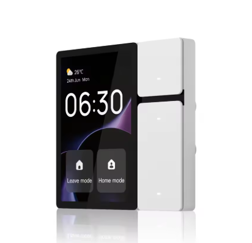
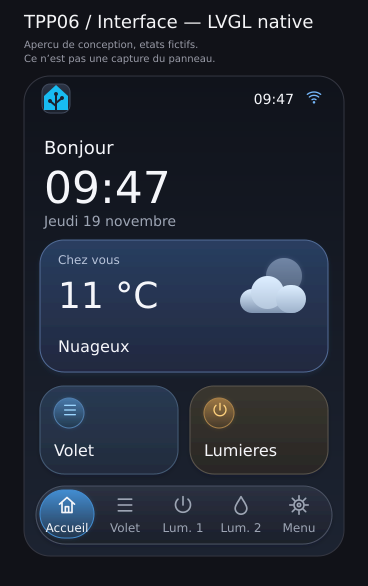

# TPP06 — local ESPHome + LVGL

**[Latest release: version, changes and limitations](https://github.com/Philiphall6/TPP06-smart-panel-project/releases/latest)** ·
[Release history](https://github.com/Philiphall6/TPP06-smart-panel-project/releases)

[Complete prerelease: ESPHome + included FR/EN assistant 0.1.0-rc3](https://github.com/Philiphall6/TPP06-smart-panel-project/releases/tag/v0.1.9-rc2)
— one ZIP includes the project, assistant, public boot logo and documentation.
See the [assistant guide](README-assistant.md). Launching it does not install panel firmware.

**[Beginner guide: start here, without dismantling](docs/en/START-HERE.md)**

[Project home](README.md) · [Français](README.fr.md)

## The TPP06 enclosure

  
  &nbsp;&nbsp;
  

*Appearance alone does not establish firmware compatibility.*

## Interface and features

- Dark rounded cards, date, clock and Home Assistant weather.
- Home Assistant logo gently pulses blue with a connected HA client, grey
  otherwise. Small clock and Wi-Fi appear in the home page’s top bar only.
- Cover/light pages, settings, brightness, sleep and diagnostics.
- Experimental BLE advertisement forwarding to HA, controlled from HA and the
  panel (no GATT/audio), plus HA backlight controls and local quiet hours.
- Local touch beep, enabled by default with a remembered off setting.
- Three physical buttons, local relays and indicators exposed in HA.
  Public configuration defaults to **observation-only** pending hardware checks.
- Available/total storage plus separate guarded ESPHome restart and Linux reboot buttons.
- On-screen Wi-Fi scan, selection and password entry require the optional Linux
  service too. **Real network migration and rollback remain hardware-unvalidated.**

See [the current interface guide](docs/en/interface.md) and
[latest release notes](https://github.com/Philiphall6/TPP06-smart-panel-project/releases/latest)
for the tested build and remaining checks. `main` may contain newer development.

## Installation and updates

OTA checks reject detected executable incompatibilities, not new ESPHome version
numbers. See the [checks and limitations](docs/en/START-HERE.md#5-update-a-panel-already-running-esphome);
post-install hardware testing is still necessary.

Native ESPHome runs on the original **Anyka ARMv5 Linux**, not an ESP32.
Compile in Home Assistant’s ESPHome Device Builder; no Mint workstation or
external build server is required. The [complete YAML](esphome/tpp06-lvgl-modern.yaml)
is editable. Use the latest release’s tagged sources for reproducibility;
keep your own keys, addresses and entity bindings private.

Download **`TPP06-HA-Panel-v<version>-sources.zip`** and its SHA256 file from
the latest release. The badge counts asset downloads, not installations, and
may be cached. The [complete template](esphome/tpp06-lvgl-complete.yaml) adds
the new modules; see [BLE, screen and YAML sections](docs/en/20-ble-screen-yaml.md).
Public relay control defaults to observation: retain the commissioned setting
when updating an already validated panel.

1. **Already running ESPHome:** [update wirelessly](docs/en/START-HERE.md#5-update-a-panel-already-running-esphome).
   Do not reinstall the overlay or supervisor for a UI update.
2. **Stock panel:** [compatibility, network access, backup and preparation](docs/en/START-HERE.md).
   Initial permanent standalone activation remains an advanced intervention.
3. **No boot or network:** see [hardware recovery archives](docs/archive/README.md).

The normal path is **network → ADB → backup → HA build → guarded trial → OTA**.
The [commissioning assistant](docs/en/13-assisted-setup.md) has offline tests,
not an end-to-end hardware validation for unassisted beginners.

> [!WARNING]
> Experimental and hardware-specific, not a universal installer. Initial
> preparation writes an overlay. Keep verified backups and on-site recovery.
> Fallback is **stock Tuya**, not automatic rollback to the previous ESPHome
> program, and does not cover kernel/NAND failures. Power loss, network loss,
> sleep/wake and endurance need installation-specific tests. Never open an
> energised mains panel or expose its ports to the Internet.

## Documentation and privacy

- [Dropbear SSH installation and root password changes (French guide)](docs/fr/19-ssh-dropbear.md)
- [Interface and limitations](docs/en/interface.md)
- [Local relays](docs/en/14-local-relays.md) · [Touch beep](docs/en/15-touch-beep.md)
- [On-screen Wi-Fi settings](docs/en/17-screen-wifi.md)
- [Remaining Tuya feature gaps](docs/en/16-tuya-gaps.md)
- [Linux hardening candidate and validation gates](docs/en/18-linux-hardening.md)
- [Network access](docs/en/00-network-authkey-access.md) · [Tuya Cutter](docs/en/07-tuya-cutter.md)
- [Native port history](docs/en/06-native-esphome-lvgl.md) · [openHASP](docs/en/05-openhasp-local.md)
- [Boot logo: separate optional advanced NAND operation, not OTA](docs/en/12-boot-logo.md)

The interface release provides **sources**, not a personal precompiled firmware.
Old ADB releases are not ESPHome programs. Build privately: executables contain
installation keys. Never publish personal YAML, `secrets.yaml`, programs,
backups, dumps or private screenshots. Public examples are fictional.

Thanks to [t0m1o1](https://github.com/t0m1o1), author of **TPPwned**, for network
AUTHKEY extraction and password derivation, and to the
[Home Assistant community](https://community.home-assistant.io/t/integration-in-ha-of-new-mini-3-5-smart-control-panel-tpp06/762516).
Independent project, not affiliated with MOES, Tuya, Home Assistant, ESPHome or LVGL.
