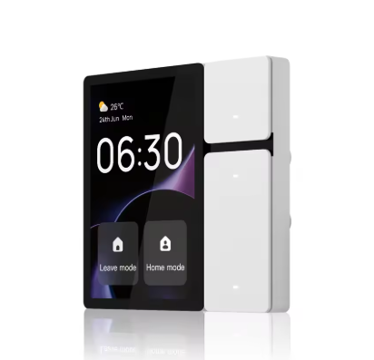
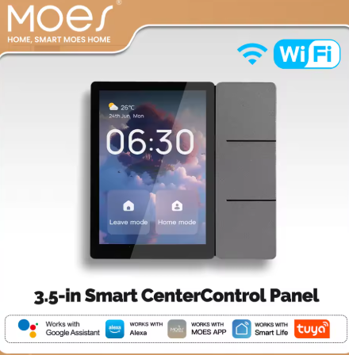

# TPP06 — documentation française

**[Dernière release : version, nouveautés et limites](https://github.com/Philiphall6/TPP06-smart-panel-project/releases/latest)**

[Release complète « Latest » : ESPHome + assistant FR/EN 0.1.0-rc3 inclus](https://github.com/Philiphall6/TPP06-smart-panel-project/releases/tag/v0.1.9-rc2)
— fonctions expérimentales et validations matérielles restantes signalées dans la release.

Un seul ZIP complet suffit. Voir [le guide de l’assistant](README-assistant.md) ;
le lancement du logiciel PC n’installe pas de firmware sur le panneau.

**[Guide débutant : commencer ici, sans démontage](docs/fr/DEMARRER-ICI.md)**

[Accueil du projet](README.md) · [English](README.en.md)

## Le boîtier TPP06

  
  &nbsp;&nbsp;
  

*L’apparence seule ne garantit pas la compatibilité du firmware.*

## Configuration et interface

ESPHome fonctionne sur **Linux Anyka**, pas sur un ESP32. Compiler dans
Device Builder sur Home Assistant ; aucun poste Mint imposé. Le
[YAML complet](esphome/tpp06-lvgl-modern.yaml) est personnalisable et les
secrets restent locaux. Prendre les sources du tag de la dernière release
pour conserver ensemble les versions des pilotes et de l’interface.

Le paquet **`TPP06-HA-Panel-v<version>-package.zip`**, accompagné de son SHA256,
se trouve dans la dernière release. Le compteur additionne les téléchargements des
fichiers encore publiés dans **toutes les releases**, SHA256 inclus, pas les
installations. Sa mise à jour peut être différée. Le [modèle complet](esphome/tpp06-lvgl-complete.yaml)
ajoute BLE, réglages d'écran dans HA, relais locaux, silence et diagnostics.
Le ZIP conserve uniquement les fichiers d’installation : assistant, scripts Linux
requis, un YAML, logo et instructions. ESPHome récupère pilotes et pages depuis
GitHub ; aucun dossier de composants à copier dans HA. Tests, photos et archives
restent dans le dépôt, hors du paquet.
Lire le [guide BLE, écran et YAML commenté](docs/fr/20-ble-ecran-yaml.md) :
les relais du modèle public restent en observation avant validation sur place.

- [Interface actuelle : météo, logo animé, navigation et paramètres](docs/fr/interface.md)
- [Relais physiques et HA](docs/fr/14-relais-locaux.md)
- [Bip tactile configurable](docs/fr/15-bip-tactile.md)
- [Wi-Fi depuis le panneau et limites du service Linux](docs/fr/17-wifi-depuis-ecran.md)
- [Écarts avec Tuya et vérifications restantes](docs/fr/16-ecarts-tuya.md)
- [Consolidation Linux : candidat et suivi des 22 domaines](docs/fr/18-consolidation-linux.md)
- [Logo de démarrage — opération NAND distincte de l’OTA](docs/fr/12-logo-demarrage.md)

## Installation et récupération

Une [fenêtre de préparation sur ordinateur](docs/fr/21-assistant-ordinateur.md)
est disponible via `Assistant-TPP06.sh` (Linux) ou `Assistant-TPP06.cmd` (Windows).
Les parcours d’installation et de maintenance sont raccordés, avec confirmations
et journaux privés. **Version expérimentale**, pas encore validée de bout en bout
sur un panneau neuf ni sur Windows réel. Voir les prérequis du paquet et les limites.

Les contrôles OTA refusent les exécutables incompatibles détectés, pas les
nouveaux numéros de version ESPHome. Voir le [périmètre des contrôles](docs/fr/DEMARRER-ICI.md#protection-technique-des-mises-à-jour)
et conserver les essais sur matériel après mise à jour.

[SSH Dropbear et changement du mot de passe root](docs/fr/19-ssh-dropbear.md) : guide manuel, sans activation automatique au démarrage.

1. [Identifier son cas et préparer HA](docs/fr/DEMARRER-ICI.md).
2. [Accès réseau](docs/fr/00-acces-reseau-authkey.md), puis
   [ADB si nécessaire](docs/fr/04-adb-wifi-sans-uart.md) et
   [sauvegarde Cutter](docs/fr/07-tuya-cutter.md).
3. Compiler son programme, puis première mise en service accompagnée.
4. Pour un panneau déjà sous ESPHome : **Installer → Sans fil**, sans
   réinstaller l’overlay, le superviseur ou le logo.

L’[assistant de transition](docs/fr/13-installation-assistee.md) reste expérimental
et testé hors ligne. Le démarrage permanent est une intervention avancée.

> [!WARNING]
> Sauvegarde et récupération sur place nécessaires. Le secours Tuya ne garantit
> pas la récupération d’une panne noyau/NAND. Veille, coupures électriques et
> perte réseau nécessitent des essais matériels ; le changement Wi-Fi n’est
> pas validé de bout en bout. Voir les notes de release avant installation.

Le démontage, la NAND et l’UART restent accessibles dans les
[archives matérielles](docs/archive/README.md), sans être des étapes ordinaires
du parcours réseau compatible. Les images du boîtier sont conservées.

## Confidentialité et crédits

Ne publier ni clés, YAML personnel, programme compilé personnel, dump ou
sauvegarde. Les sources publiques sont portables ; chaque panneau conserve
ses propres identifiants et paramètres.

[Historique des releases](https://github.com/Philiphall6/TPP06-smart-panel-project/releases) ·
[Historique ESPHome](docs/fr/06-esphome-lvgl-natif.md) ·
[openHASP](docs/fr/05-openhasp-local.md) · [Remerciements à TPPwned et à la communauté](README.md#remerciements)
