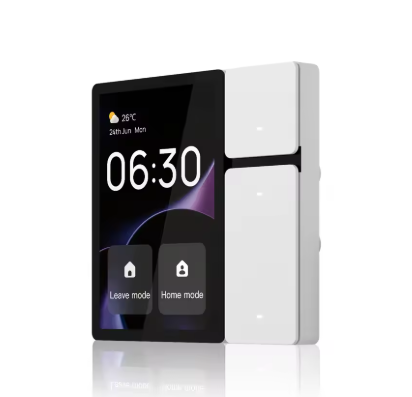

# TPP06 · Local, sans Tuya

> Redonner le contrôle local à un panneau **MOES / Tuya TPP06** : récupérer d’abord son accès propre par le réseau local, comprendre le matériel si nécessaire, accéder au système, puis remplacer les dépendances cloud par une intégration ESPHome locale.

[🇫🇷 Documentation française](README.fr.md) &nbsp;·&nbsp; [🇬🇧 English documentation](README.en.md)

## Commencer ici — accès réseau sans démontage

La nouvelle **étape 0** récupère en lecture seule l'`AUTHKEY` du panneau sur le réseau local et calcule son mot de passe `root`/ADB. Elle ne nécessite ni UART, ni ouverture du boîtier, ni dessoudage de la NAND.

```bash
python3 tools/tpp06_authkey_reader.py ADRESSE_IP_DU_PANNEAU
```

- [Guide français — récupération réseau de l'AUTHKEY](docs/fr/00-acces-reseau-authkey.md)
- [English guide — network AUTHKEY recovery](docs/en/00-network-authkey-access.md)
- [Outil Python en lecture seule](tools/tpp06_authkey_reader.py)

L'outil masque l'`AUTHKEY` et n'affiche jamais les éventuels identifiants Wi-Fi présents dans la réponse.

## Les deux variantes du panneau

<p align="center">
  
  &nbsp;&nbsp;
  
</p>

*Visuels de référence des deux panneaux utilisés dans le projet.*
---

## Le projet en quatre étapes

| Étape | Objectif | État |
|:--|:--|:--|
| **00 · Accès par le réseau** | Lire l'`AUTHKEY` sur le port local `8090`, puis calculer le mot de passe propre au panneau sans démontage. | ✅ Vérifié |
| **00b · Candidats communautaires** | Essayer la petite liste connue seulement si la récupération réseau n'est pas disponible. | ✅ Documenté |
| **01 · Matériel & NAND** | Créer une sauvegarde vérifiée si les méthodes sans démontage échouent ou si une analyse matérielle est nécessaire. | ✅ Terminé |
| **02 · ADB/USB ou UART** | Utiliser en priorité ADB par USB avec le mot de passe récupéré ; conserver l'UART comme solution de secours. | 🟡 En cours |
| **03 · Local & ESPHome** | Conserver l’Anyka, modifier le logiciel pour retirer Tuya et fournir un accès local à ESPHome. | 🔜 Préparé |

## Commencer par l’étape 0

Utiliser d'abord le [lecteur réseau AUTHKEY](docs/fr/00-acces-reseau-authkey.md). Le panneau expose son service de test sur le port TCP `8090`; l'outil active temporairement son contexte de lecture, demande la configuration et calcule les huit derniers caractères hexadécimaux du MD5 de l'`AUTHKEY`. Il n'envoie ni écriture persistante, ni redémarrage, ni mise à jour OTA.

Si cette méthode n'est pas disponible, essayer ensuite la [liste de mots de passe communautaires](docs/fr/00-mots-de-passe-a-essayer.md), puis envisager l'UART ou la sauvegarde NAND seulement en dernier recours.

L'ordre pratique devient donc : **réseau → ADB par USB → candidats communautaires → UART/NAND en dernier recours**.

## Prochaine étape : accès système par ADB

Le mot de passe propre au panneau étant désormais récupéré sans démontage, la prochaine session doit privilégier ADB par USB. L'UART reste une solution de diagnostic et de secours, mais n'est plus nécessaire pour obtenir le mot de passe.

Une fois cet accès complet validé, l’étape 3 commencera :

- comprendre comment Tuya démarre et communique ;
- conserver l’interface, l’écran et le processeur **Anyka** déjà présents ;
- créer ou adapter un service local, sans cloud ;
- exposer les commandes et états du panneau à **ESPHome** ;
- désactiver Tuya seulement après validation du fonctionnement local.

[Voir le plan de l’étape 3 en français →](docs/fr/03-suppression-tuya-esphome.md)
[See the Phase 3 plan in English →](docs/en/03-remove-tuya-esphome.md)

## Ce que contient le dépôt

- guides matériels, brochages et retours d’expérience ;
- outil réseau en lecture seule pour récupérer l'accès propre au panneau ;
- photos de la lecture de la NAND et du remontage ;
- procédure UART réversible ;
- feuille de route pour une intégration ESPHome locale.

Les dumps NAND, hashes, identifiants propres à un appareil, clés et données personnelles restent hors du dépôt. Les mots de passe de l’étape 0 sont une liste communautaire de candidats à essayer, et non des données extraites d’un appareil.

## Remerciements

Merci à **[t0m1o1](https://github.com/t0m1o1)**, auteur de TPPwned et collaborateur du projet, ainsi qu'aux participants du fil [*Integration in HA of new mini 3.5 smart control panel TPP06*](https://community.home-assistant.io/t/integration-in-ha-of-new-mini-3-5-smart-control-panel-tpp06/762516/120?page=6) sur la communauté Home Assistant. Leurs travaux ont permis l'extraction réseau de l'`AUTHKEY`, l'exploration matérielle et la lecture de la NAND.

---

*Projet communautaire indépendant, sans affiliation avec MOES, Tuya, Home Assistant ou ESPHome.*
