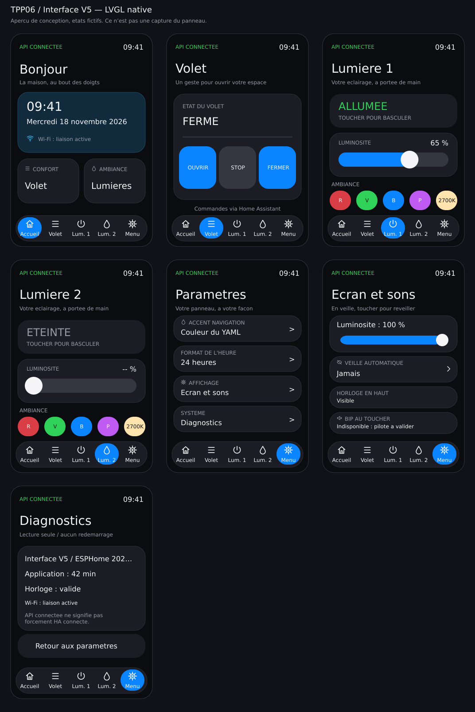

# TPP06 · ESPHome + LVGL, en local

Une interface tactile personnalisable pour le panneau **MOES / Tuya TPP06**,
reliée à Home Assistant. ESPHome fonctionne sur le **Linux Anyka d’origine** :
ce n’est pas un ESP32 et il ne faut pas lui envoyer un firmware ESP32.

**[Commencer ici — guide débutant français](docs/fr/DEMARRER-ICI.md)** ·
**[Start here — English beginner guide](docs/en/START-HERE.md)**

[Documentation FR](README.fr.md) · [English documentation](README.en.md) ·
[Archives démontage / NAND / UART](docs/archive/README.md)

## Le boîtier TPP06

  
  &nbsp;&nbsp;
  

*Visuels de référence des deux variantes du boîtier. L’apparence seule ne garantit pas la compatibilité du firmware.*

## État actuel — 18 novembre 2026

- **Correctifs V5 `0.1.5-colors.1` installés** : couleurs RGB565 confirmées
  visuellement et présentation de l'image corrigée. [Détails affichage](esphome-components/fbdev/README.md).
- **Trois relais locaux** : touches haut/milieu/bas confirmées sur les canaux
  1/2/3, voyants synchronisés, switches exposés par l'API. Le package public
  reste en observation par défaut ; [essais hors réseau encore à faire](docs/fr/14-relais-locaux.md).
- [Logo de démarrage](docs/fr/12-logo-demarrage.md) réencodé en RGB565 et
  relu après écriture ; sa couleur au prochain démarrage reste à confirmer.
- [Interface météo V6](esphome/tpp06-lvgl-modern.yaml) publiée comme **candidate** :
  pas encore compilée ni installée sur le panneau. Bip toujours indisponible.
- **V5 / projet `0.1.5` installée sur le panneau de référence** après une
  installation sans fil annoncée réussie par son propriétaire. Vérifications
  directes : binaire conforme, API chiffrée accessible, Wi-Fi associé,
  superviseur sain et politique de démarrage persistante conservée.
- Capture réelle de l’accueil vérifiée : navigation avec icônes, heure, date,
  liaison Wi-Fi et menu. L’aperçu ci-dessous utilise des données fictives.
- Compilation dans **ESPHome Device Builder sur Home Assistant** ; aucun
  ordinateur Mint ni serveur de compilation externe obligatoire.
- YAML entièrement éditable : pages, titres, couleurs, entités de votre maison.
  Les pilotes viennent de GitHub ; les secrets restent chez vous.
- Veille **désactivée par défaut**. Réveil tactile, secours pendant la veille,
  bip, coupures électriques et endurance longue durée restent à valider.

> [!WARNING]
> Projet expérimental, vérifié sur un matériel précis, pas un installateur
> universel. La première préparation réseau écrit un overlay et peut rendre
> une variante incompatible inutilisable. Sauvegardes et récupération locale
> sont nécessaires. **Sans démontage ne signifie pas sans risque.**
> Ne pas ouvrir un panneau sous tension et ne jamais exposer ses ports sur Internet.

## Choisir le bon parcours

| Votre situation | Prochaine étape |
| --- | --- |
| ESPHome fonctionne déjà sur votre panneau | [Mise à jour OTA, sans réinstaller le démarrage](docs/fr/DEMARRER-ICI.md#5-mettre-à-jour-un-panneau-déjà-sous-esphome) |
| Le panneau est encore d’origine | [Compatibilité, accès réseau, sauvegarde et préparation](docs/fr/DEMARRER-ICI.md) |
| Le panneau ne démarre plus ou n’a plus de réseau | [Récupération avancée / archives matérielles](docs/archive/README.md) |

Le parcours courant est **réseau → accès ADB → sauvegarde → compilation dans
HA → essai encadré → mise à jour OTA**. Le démontage, l’UART et le dessoudage
NAND ne sont plus des étapes normales du tutoriel.

La première activation autonome permanente reste une intervention avancée :
le Cutter standard conserve une sélection ponctuelle et ne confirme pas
automatiquement le mode persistant. Son secours revient à **Tuya d’origine**,
pas automatiquement à la précédente version ESPHome. Voir le guide avant
de sélectionner un démarrage ou de redémarrer.

## Documentation et fichiers

- [Assistant de première mise en service — tests hors ligne uniquement](docs/fr/13-installation-assistee.md)
- [Interface V5 : fonctions, validation et limites](docs/fr/11-interface-v5.md)
- [Configuration complète V5 à personnaliser](esphome/tpp06-lvgl-mobile.yaml)
- [Accès réseau sans démontage](docs/fr/00-acces-reseau-authkey.md)
- [Préparation ADB par Wi-Fi — avancée](docs/fr/04-adb-wifi-sans-uart.md)
- [Tuya Cutter : sauvegarde, contrôles, restauration](docs/fr/07-tuya-cutter.md)
- [Détails du portage ESPHome et historique des essais](docs/fr/06-esphome-lvgl-natif.md)
- [Portage openHASP — autre voie expérimentale](docs/fr/05-openhasp-local.md)
- [Logo de démarrage — opération distincte, facultative et avancée](docs/fr/12-logo-demarrage.md)

Les anciennes releases ADB ne sont **pas** des firmwares V5. Compiler son
propre programme : il contient les clés et paramètres de son installation.
Ne pas publier de binaire personnel, capture privée, dump, sauvegarde,
`secrets.yaml`, adresse réelle ou identifiant de maison.

## Remerciements

Merci à [t0m1o1](https://github.com/t0m1o1), auteur de **TPPwned**, pour la
découverte de l’extraction réseau de l’AUTHKEY et du calcul du mot de passe,
ainsi qu’aux participants du [sujet Home Assistant](https://community.home-assistant.io/t/integration-in-ha-of-new-mini-3-5-smart-control-panel-tpp06/762516).

Projet communautaire indépendant, sans affiliation avec MOES, Tuya,
Home Assistant, ESPHome ou LVGL.
