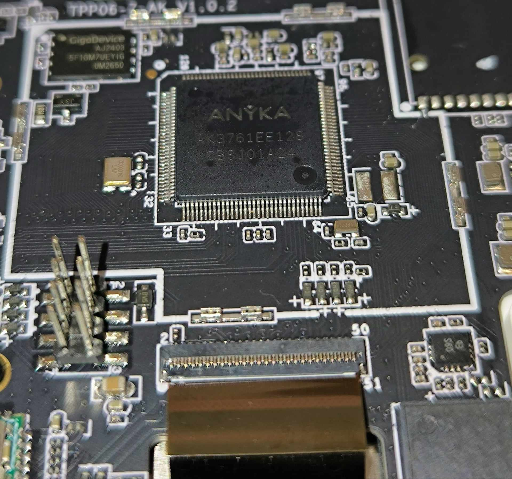
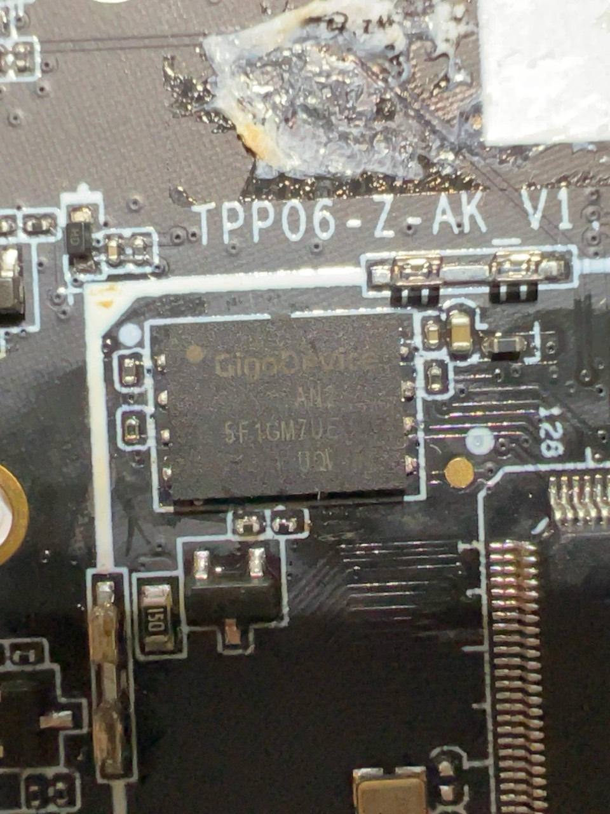
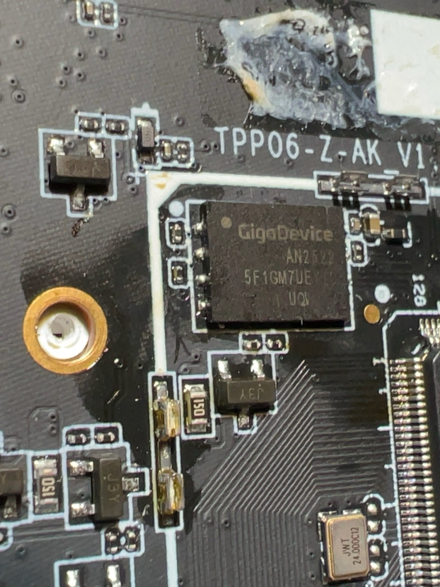
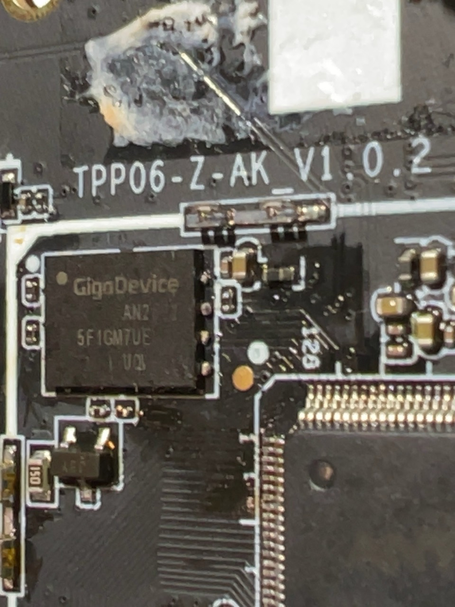
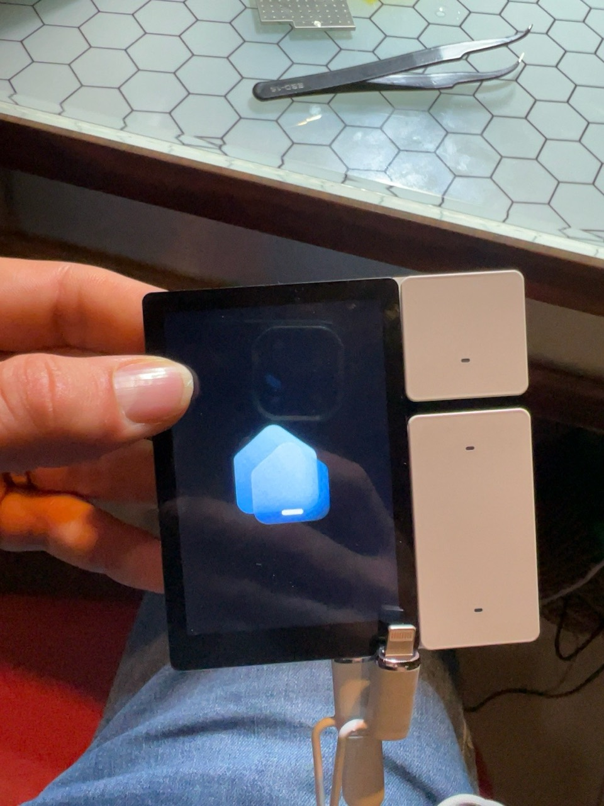

> **Archive historique — récupération matérielle, pas le parcours normal d’installation.**
> Commencer par le [guide débutant sans démontage](../../fr/DEMARRER-ICI.md). Les états ci-dessous sont historiques.
> Ouvrir un panneau secteur ou intervenir sur la NAND présente un risque de blessure et de panne définitive.
> Couper toutes les alimentations ; réserver ces opérations aux personnes qualifiées.

# Carte et remontage

## Références

- La vue d'ensemble portant une étiquette d'identification du panneau n'est
  pas distribuée ; les détails de la NAND ci-dessous restent disponibles.
- Référence recto : photographie historique non distribuée dans le dépôt.
- 

## Ressoudage

Le point doré de la NAND est le repère de broche 1. Il doit être face au repère de broche 1 sur le circuit imprimé.

- 
- 
- 

Après nettoyage du flux, vérifier visuellement l’absence de pont de soudure avant remise sous tension.

## Validation

Le logo de démarrage du panneau est apparu après le remontage :

