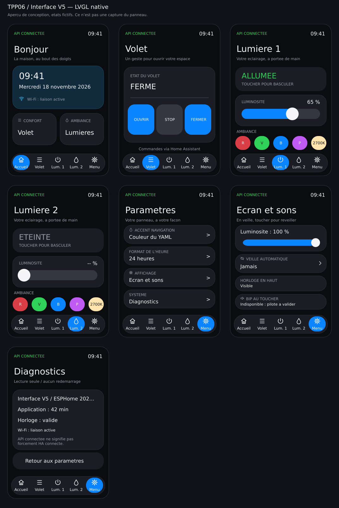

# Phase 6 — Native ESPHome + LVGL on the TPP06

> **Advanced reference / trial history.** Start with the current
> [beginner guide](START-HERE.md). [V5](11-interface-v5.md) is now installed
> and checked on the reference panel with persistent policy retained. Earlier
> “not installed” statements below describe past trials; power-cycle testing
> is still outstanding.

> [!CAUTION]
> **ESPHome boot remains experimental.** Temporary execution from `/tmp` is
> validated. The Phase 7 multiboot V1 supervisor now retains Tuya, Wi-Fi, and
> port 8090 as a rescue path, but still needs a real power-cycle validation.
> Keep UART available for that first test.

This route runs **ESPHome itself** on the TPP06 Anyka Linux system. ESPHome's
LVGL engine writes directly to the framebuffer and reads the Goodix touchscreen
through Linux `evdev`; no ESP32 replacement is involved.

> **Hardware-tested on 17 November 2026.** The static ARMv5 program starts on
> the TPP06, detects its 320×480 BGR565 framebuffer and Goodix touchscreen, and
> completes ESPHome setup. The LVGL button responds to touch and displays
> `TACTILE OK`. Persistent startup now has automatic fallback and an explicit
> opt-in guard, but is not hardware-validated yet.

The [reproducible patch](../../esphome-lvgl/esphome-tpp06-lvgl.patch) adds:

- a `/dev/fb0` 320×480 16-bit `fbdev` display component;
- automatic RGB565/BGR565 detection;
- an `/dev/input/event1` Goodix `evdev` touchscreen component;
- the 16-byte 32-bit input-event layout required by the panel's Linux 4.4
  kernel;
- legacy ARM32 Linux 4.4 time and select syscalls for a modern time64 toolchain;
- explicit static `pthread` linkage and a writable `ESPHOME_PREFDIR`;
- an LVGL colour/touch test and an ARMv5 cross-build script.

It targets ESPHome revision `9bf2bbc` (`dev`, `2026.12.0-dev`) and the official
Bootlin ARMv5 EABI/uClibc stable 2026.08-1 toolchain (GCC 15.3):

```bash
git clone https://github.com/esphome/esphome.git
cd esphome
git checkout 9bf2bbc
git am /path/to/esphome-tpp06-lvgl.patch

export TPP06_TOOLCHAIN_PREFIX=/opt/armv5-eabi--uclibc--stable-2026.08-1/bin/arm-linux
export ESPHOME_PYTHON=/path/to/esphome-venv/bin/python
./tpp06/build.sh
```

The result is
`tpp06/.esphome/build/tpp06-lvgl/.pioenvs/tpp06-lvgl/program`. The first build
produced a roughly 2.8 MiB static binary with SHA-256:

```text
9d2d42251db95ff8564c90cb2d978cf398a214fecc04ed302f6717d78e726802
```

## Portable Device Builder configuration

The compatibility layer is provided as ESPHome `external_components`; patching
ESPHome itself is no longer required. Import only
[`esphome/tpp06-device-builder.yaml`](../../esphome/tpp06-device-builder.yaml)
into the official Device Builder. Installation-specific values are collected
in the top-level `substitutions`: unique device name, panel address (`device_address`), private key reference, and the
three Home Assistant entity IDs. The Linux drivers and LVGL interface are
fetched from this repository.

Two modes are available. `tpp06-device-builder.yaml` stays linked to the GitHub
template and is convenient when only substitutions change. For unrestricted
interface editing, import `tpp06-lvgl.yaml`. The advertised **Take control**
flow uses `import_full_config: true`, so Device Builder copies the complete
configuration locally. Pages, widgets, styles, positions, and actions can then
be edited freely; only the hardware `external_components` remain sourced from
GitHub.

An ARMv5 cross compiler is still required, but no external build server is
needed. The external `host` component detects the Home Assistant architecture:
it uses the Bootlin toolchain on x86-64 and native Zig on Raspberry Pi/aarch64.
The selected archive is downloaded into Device Builder's cache, SHA-256
verified, and reused. Every build therefore runs locally inside Home Assistant;
the initial download takes longer.

If the build log contains a `.remote_builds/...` path, compilation is still
being offloaded. Open **Settings → Send builds**, remove or disable the paired
build server, then clean this device's build files. A normal local path starts
with `/config/.esphome/build/...`.

The new template requires `tpp06_api_encryption_key` in `secrets.yaml`: a private,
installation-specific random 32-byte base64 key for API and OTA encryption.
Never commit it. When migrating an already encrypted OTA endpoint, retain its
existing key for the first upload.

For a new installation only, generate the key locally with
`openssl rand -base64 32` and store the result as `tpp06_api_encryption_key`
in Device Builder's `secrets.yaml`. Never use the repository's test key.
GitHub supplies no credentials.

### Time without Tuya cloud

The template uses the standard ESPHome
[`time: platform: homeassistant`](https://esphome.io/components/time/homeassistant/)
component. Time comes through the existing encrypted API; no NTP server,
Tuya cloud access or additional credentials are added. The public YAML does
not pin a timezone: Home Assistant supplies the installation's timezone.

After a cold boot, Linux time may remain in 1970 until Home Assistant connects.
A connected log client does not prove HA has supplied time. Check
`time.has_time` before using it for scheduled actions. `api.reboot_timeout: 0s`
is retained: missing HA must not cause a reboot loop.

The HA-built v3 binary then completed a 300-second standalone session: time
was correct before the first diagnostic API connection, nine encrypted probes
succeeded, and observed resident memory remained at 4,932 KiB. Container ADB
was offline, so monitoring resumed through Mint; detailed samples are missing
from the first few minutes. Automatic stock recovery, original file checksums
and 90 seconds of subsequent stock stability were verified. Standalone OTA
and permanent installation are not yet validated. The previous 15-minute
trial binary did not contain this addition.
Supervisor delays use relative waits; host HAL timers use `CLOCK_MONOTONIC`,
not the wall clock being synchronized.

### iOS-inspired mobile variant

The complete [tpp06-lvgl-mobile.yaml](../../esphome/tpp06-lvgl-mobile.yaml)
offers an alternative native 320 × 480 interface: rounded dark cards, fixed
navigation, a welcoming home page with date and greeting, a cover page, two
light pages, settings and diagnostics. It retains the
classic template's drivers, API/OTA encryption and control IDs. Buttons are
at least 44 × 44 pixels. Brightness values come from HA; state updates never
send household commands. Color controls require a light supporting them.

**Accueil** (Home) is the startup page. The French date and clock use the
HA-synchronized time; placeholders remain until valid. Shortcuts navigate
without operating household devices. Wi-Fi status only reads Linux's
`carrier` file for `network_interface` (default `wlan0`): link active,
no link, or unknown. It does not measure signal strength or prove Internet/HA
connectivity. No SSID, password or IP address is displayed.

**Menu** offers 12/24-hour format, top-bar clock visibility (the home clock
stays visible), and purple or YAML `ui_accent` navigation highlighting.
These three preferences use ESPHome storage and require a writable
`ESPHOME_PREFDIR`, provided by this project's supervisor. Diagnostics show
version, application uptime (not Linux uptime), clock validity and Wi-Fi
link status. The global API indicator may also reflect a logging client.
These pages never reconfigure networking, reboot or erase anything.
Settings persistence and rendering of pages other than Home still require
on-device verification.



**V4 built in Home Assistant and tested temporarily, not installed permanently.**
On 18 November 2026, a personal configuration derived from this template,
with pinned drivers, ran a standalone session limited to 300 seconds without
a competing Tuya GUI. All 16 encrypted API probes succeeded; observed resident
memory remained at 5,352 KiB. Actual beginning/end framebuffer captures show
the home page, date and Wi-Fi link status without visible overlap. No touches,
household commands or OTA transfers were sent during this trial.

The supervisor log confirms the scheduled stop at 300 seconds. Stock recovery
was verified after the recovery reboot, followed by 90 seconds of stability,
associated Wi-Fi and all four tracked original files restored or unchanged.
One ADB sample failed during the return transition; it is not counted as a
successful API probe. The main installed executable was not replaced, and
global selections remain `tuya` / `learning`.

**Known issue:** the final capture shows a clock one hour behind the initial
local-time display. Initial synchronization had occurred before the first
diagnostic API probe; this does not validate timezone retention throughout
the session. Interaction with diagnostic API clients still needs investigation:
the inspected `aioesphomeapi` version automatically answers time requests with
its own timezone. A probe sending no household commands is not a passive
clock observer.
Do not treat the clock as validated for scheduled actions. Menu/settings pages,
preference persistence, standalone OTA and permanent boot remain unvalidated.

Four conditional text expressions explicitly construct `std::string`; otherwise
generated C++ called `.c_str()` on a `const char*`. A C++ generation regression
test covers this issue, and all 76 offline tests pass. The hardware executable
was compiled in HA, not on Mint. Actual captures and personal configurations
stay private. The preview above uses fictional states and browser fonts;
it is not a panel screenshot.

Copy this file under a new name in Builder, choose a unique `device_name`,
and customize entity, title and `ui_*` color substitutions. Retain an existing
private key only when updating that same panel; another installation must
supply its own secrets. All coordinates and widgets remain editable, with
no cloud fonts, external images or personal information required. Compile
and download in HA, check space, then run a bounded trial before changing
boot behavior. Never launch OTA during an automated trial. The existing
personal YAML is not automatically replaced.

References: [LVGL](https://lvgl.io/) and
[ESPHome LVGL widgets](https://esphome.io/components/lvgl/widgets/).

### Moving to another installation

1. Import the public YAML. Components come from GitHub; no Mint computer path
   or local component directory is required.
2. Choose a unique name per panel and customize entities and labels. Retain
   the known IP during migration; use `.local` only after discovery has been
   verified from the new HA server.
3. For the same panel, transfer its existing key privately; for a new panel,
   generate a new key. Keep private backups of the customized YAML and
   `secrets.yaml`.
4. Compile inside Home Assistant using the tested ESPHome version (2026.10.2).
   Internet access is needed for initial component/toolchain downloads. No
   GitHub account or Mint build server is required.
5. Validate in a bounded trial before changing boot behavior. A portable
   template does not mean permanent installation is validated.

For reproducible installations, pin the same tested commit in both GitHub
`packages` and `external_components` references instead of following `main`.
Never publish a personalized executable: it can embed the API/OTA key and
home entity IDs even though its source is public. mDNS multicast must reach
HA; across VLANs, retain an explicit address until an mDNS relay is configured
and tested.

## Initial deployment and later OTA updates

### Real MAC and mDNS discovery — initial on-panel trial passed

The new template uses `host.network_interface: wlan0` to read the panel's real
MAC through ioctl, never the build server's MAC. It rejects invalid identities
instead of silently falling back to a shared synthetic MAC. Remove the old
`host.mac_address`; the two options are mutually exclusive.

On 18 November 2026, a 150-second trial on a real RAM copy passed four
encrypted API connections and rejected a plaintext connection. The API MAC
matched `wlan0`. A, PTR, SRV and TXT replies queried from the HA SSH host
confirmed the `.local` name, API port, MAC and Noise marker. Automatic stop
preserved Tuya, ADB and the flash program without a Linux reboot. No household
equipment was controlled.

During a subsequent bounded RAM trial, the HA entry stored the new identity
and the key matching the private YAML. A TCP connection from HA was observed,
and the update entity remained registered. This does not validate household
actions or existing automations. The YAML can now reference GitHub components at a pinned
commit without a local component directory. Keep a private backup before migration.

A subsequent encrypted OTA trial of the new build completed its transfer, but
the log recorded two successive updates although the test requested one.
An API check timed out during the second transfer; a later encrypted check
succeeded. The flash program remained unchanged and bounded stop preserved
Tuya. The second transfer's origin is not yet confirmed, so this does not
validate a complete isolated OTA sequence. Do not launch Builder's Install
action while an automated OTA trial is running.

A subsequent five-minute bounded trial verified one encrypted OTA transfer
of the same build to a real RAM copy. Sender retries were disabled: one upload
call, one incoming connection observed by TCP sampling (matching source port),
and one device commit were recorded. Three post-transfer encrypted API checks
passed, and HA reconnected. The flash program checksum stayed unchanged, Tuya
remained active, Linux did not reboot, and automatic stop succeeded. The complete
network trace was retrieved after the initial report had collected it too early.
This is not a full packet capture and does not retrospectively explain the
previous duplicate transfer. It does not validate Builder's Install button,
a version change, or permanent boot. The RAM copy was removed after verification;
evidence is retained privately.

Builder's **Install → Wirelessly** workflow was subsequently tested during
a 20-minute RAM session. The user reported installation success; panel-side
checks confirmed one committed update, one sampled TCP peer, 49 successful
post-transfer encrypted API checks and the planned automatic stop. The Tuya
process remained running and the flash program stayed unchanged. The received
binary was saved privately before removing the temporary copy. This validates
neither persistent installation nor display ownership.

### Shared display: OTA success is not LVGL interface validation

During that trial, both programs opened `/dev/fb0` and `/dev/input/event1`.
The actual screen capture showed Tuya's clock, not an ESPHome page. Sharing
the framebuffer permits competing writes; an available API does not prove
that ESPHome owns the screen.

Run the read-only [tpp06_display_check.sh](../../tools/tpp06_display_check.sh)
with `sh` on the panel through an already authenticated console. It reads
`/proc` and sysfs geometry without opening devices, sending signals, changing
network configuration or rebooting. `CHECK_SHARED_FB0=yes` means both programs
hold open descriptors; `not_observed` is **not** proof of exclusive ownership.
The output contains no network address or key.

The installed firmware was retrieved read-only and checksum-verified; it
differs from the old dump. In this firmware, `tal_disp_stop` only checks its
argument and prints a diagnostic; `tuya_gui_hal_exit` calls `ak_tde_exit` and
is not a validated reversible GUI pause. A `gui_watchdog` task is also present.
Do not suspend all of Tuya with `SIGSTOP` to work around this remotely.
Live display handover while retaining networking and recovery access still
needs validation. No Tuya application modification was applied for this trial.

Further analysis shows that a Tuya LVGL timer feeds its GUI watchdog every
two seconds. Its event loop must keep running; stopping the GUI task is not
equivalent to suppressing rendering. The library is also linked with
`DT_SYMBOLIC` and uses local calls: replacing an exported function through
simple preloading is not a validated interception point. Both programs also
open the touchscreen; hiding only the image would not ensure that Tuya stops
handling touches.

The prepared path therefore remains standalone mode: start networking and
recovery independently, then let ESPHome alone manage display and touch.
Active-profile selection and rejection of falsely isolated sessions are
corrected and tested offline; see [network preparation](07-tuya-cutter.md#learning-and-independent-wi-fi).
Subsequent separate cold-start trials verified independent networking, LVGL
display and stock recovery within the limits documented in the
[trial report](07-tuya-cutter.md#15-minute-standalone-trial). They do not validate
live handover, a real network failure or a power cut. On-site recovery access
remains necessary.

`tpp06_mdns` publishes native ESPHome service records over IPv4, including the
real MAC and encryption state, and the `device_name.local` hostname. Use a unique
device name per panel. The adapter follows DHCP address changes and stops
publishing on name conflicts while keeping direct IP access available.
Schema validation, code generation, ARMv5 syntax checks and the bounded DNS-SD
trial pass. HA pairing registration and Builder OTA in RAM were verified;
automatic adoption, DHCP changes,
name conflicts and long-term stability still need validation. These checks do
not validate permanent boot.

Retain the known IP in `device_address` during migration. Switch to
`${device_name}.local` only after resolution/discovery works from HA. Replacing
the old synthetic MAC may create a new HA identity; keep the old entry until
entity links and automations have been checked.

### Migrating a previous synthetic MAC in Home Assistant

Reauthentication may report a different device even with the correct key:
the old entry expects the synthetic MAC, while the new program reports the
MAC of `wlan0`. Do not restore a shared MAC to bypass this check, and do not
delete the previous entry as a first step.

1. Check that the ESPHome trial is still active and its API responds. After
   automatic stop, ADB may remain available without an ESPHome API listener.
2. Close the error and open **Settings → Devices & services → Add integration
   → ESPHome** (not Device Builder).
3. Enter the panel address, API port `6053`, and the private value referenced
   by `api.encryption.key`. Do not enter the secret's name or generate another key.
4. If HA offers name conflict resolution, choose **Migrate**, not **Overwrite**,
   to retain the previous entry's configuration.
5. Verify the new identity, encrypted connection and entity associations.
   A dialog closing by itself does not confirm pairing.

See the [official HA ESPHome migration procedure](https://www.home-assistant.io/integrations/esphome/#name-conflict-resolution).
This procedure neither extends a bounded trial nor enables permanent boot.
Do not publish keys or screenshots containing secrets.

### IP fallback and older versions

In the examined ESPHome 2026.10.2 version, `mdns_host.cpp` does not actually
publish mDNS services. The external `host` component therefore adds
`use_address`: the explicit address reaches `CORE.address`, Builder metadata,
and logging/deployment commands. No installed ESPHome files are modified.
For older builds without the mDNS adapter:

```yaml
substitutions:
  device_address: "192.0.2.1"  # Replace with the actual panel address.
host:
  use_address: "${device_address}"
mdns:
  disabled: true
```

Merge these keys into existing sections, retaining other `host` options.
This neither changes the panel's Wi-Fi settings nor implements mDNS. A DHCP
reservation avoids address changes. The compatibility bridge disables the
validated-config fast cache only for `host.use_address` configurations, so
logging and deployment reload the external component. Build caches remain.

After editing, validate the YAML and refresh Builder; do not start an
installation merely to check its address. Local tests cover validation,
metadata, and caching. On 18 November 2026, Builder displayed the panel online
and its logs confirmed API connection, handshake, and ESPHome log messages
during a bounded trial. An **encrypted** OTA of the validated HA-built binary
has subsequently passed on a real RAM copy: replacement, re-exec, API return,
and bounded stop were confirmed, with no flash-program change or Linux reboot.
The Builder Install-button workflow also passed in RAM, as detailed above. When using local driver sources,
keep the component directory with the YAML when moving to another installation.

Outside trials, ESPHome is deliberately stopped, so offline is expected then
as well. The unencrypted badge refers to the API without a configured Noise
key, independently of OTA security. The tested binary already required encrypted
OTA while its API was plaintext.

### Read-only API check

In a Python environment containing `aioesphomeapi` (such as ESPHome's), during
an active temporary trial:

```bash
python tools/tpp06_api_check.py PANEL_IP
```

The check connects using the ESPHome protocol, reads program information and
lists entities. It does not upload, reboot or command any equipment. Supply
`ESPHOME_API_KEY` through the environment if encryption is configured; never
commit it. A reachable API does not prove Home Assistant is connected or
authorized to perform actions.

The template now displays **API CONNECTEE** rather than treating every log
client as Home Assistant. It exposes version and uptime diagnostic entities,
and does not label unknown/unavailable lights as off. These changes require
a new validated build and deployment; they do not alter the installed binary.
Check the panel's ESPHome integration options in Home Assistant separately
before allowing Home Assistant actions. The diagnostic never changes this
permission or tests relays.

Additional hardware trial on 18 November 2026: two full API protocol reads
succeeded during a 120-second bounded session. The existing binary reported
zero entities and zero user services. An established TCP connection from Home
Assistant was observed; this does not validate actions, which remain disabled
in the integration. After automatic stop, the ADB shell responded, uptime
continued and the stock Tuya process remained unchanged. No reboot was sent.

A subsequent 180-second bounded trial confirmed Device Builder connection and
log reception, plus multiple independent API reads. At 65 and 125 seconds the
supervisor reported `esphome-healthy` with an established TCP connection from
Home Assistant. Automatic stop at 180 seconds ended with `session-complete`
and no counted failure; the ADB check at 186 seconds confirmed uninterrupted
uptime and the same stock Tuya process. This does not validate home automation
actions, OTA, or standalone boot.

A new executable compiled in Home Assistant on 18 November 2026 (7,640,472
bytes, ARMv5TE EABI5 soft-float without a dynamic interpreter) subsequently
passed two 120-second trials: a separate real copy in RAM, then execution
from flash. API checks passed at 5, 65, and 110 seconds in both trials.
Scheduled stops preserved uptime, ADB, and the stock Tuya process, with no
counted failures. This binary still exposes zero entities and zero user
services: the template's new diagnostics are not yet in this personal config.

Replacement used a staging file on flash, checksum verification, then rename,
with a verified backup of the old executable on Mint. Ten old log archives
were backed up and removed from the panel to retain the 2 MiB reserve during
transfer. After replacement, `/data` had about 22.8 MiB free. No reboot was
sent; Tuya remains selected for the next boot. This controlled replacement
does not validate Builder's OTA protocol.

The online badge alone does not prove ESPHome is running: Builder may regard
the Linux system as reachable while its API port is closed. A `Connection
refused` error on port 6053 after a bounded trial expires is expected and does
not mean the panel rebooted. Check supervisor logs and uptime separately
before concluding that a crash occurred.

### OTA storage requirement

The host OTA backend stages `.ota.new` alongside the running executable, so
both versions must fit at the same time. The examined test binary is about
19.7 MiB, with about 8.6 MiB free on `/data`: another copy of that size cannot
fit. The template adds `-Wl,--strip-all` to omit debug/symbol tables from the
next build. Check its actual size and available storage before any OTA;
stripping alone does not guarantee sufficient space. Do not replace the
program during an unattended trial without backup and recovery access.

Before transferring to the installed flash executable, check storage:

```bash
python3 tools/tpp06_tuya_cutter.py PANEL_IP ota-space-check --binary program
```

This diagnostic transfers and deletes no files. It reserves 2 MiB, never
counts the old executable as free space, and rejects an active target other
than the expected flash executable. It does not disable Builder's Install
button: respect its result before OTA. Success validates neither binary
architecture nor the transfer itself.

Measurement on 18 November 2026: stripping debug symbols from a copy of the
existing program reduces it from 20,679,080 to 7,990,192 bytes. Loadable segments
remain identical apart from section-table references in the ELF header.
With 8,990,720 bytes free on `/data`, staging is still 1,096,624 bytes short
of retaining the 2 MiB reserve. This copy was not deployed; measure the next
program after compiling it in Home Assistant.

**A symlink-based temporary trial does not isolate OTA.** The host backend
resolves `/proc/self/exe`, so updating can replace the symlink's flash target.
Do not use OTA to test a new version in that kind of trial. A future isolated
OTA trial requires a separate real copy and RAM/storage checks. In the
examined host code, OTA restart re-executes the program with `execv`, not the
Linux system; this does not guarantee the new program will work.

Device Builder cannot use **Install** to place the very first executable into
an untouched Tuya system. The build itself succeeded when the log says
`Successfully compiled program`; download that executable and deploy it
reversibly with Tuya Cutter as described below.

From project version `0.1.3`, the running executable provides ESPHome OTA on
port `8082`. Later builds can therefore be installed directly to the panel's
address from Device Builder. Older configurations use `ota_password`; the new
template requires encrypted OTA. Portable MD5 and SHA-256 backends
in this repository avoid the OpenSSL dependency missing from Tuya Linux.

Starting with version `0.1.4`, this local build also works when Device Builder
runs on an ARM64 Raspberry Pi. After upgrading from `0.1.3`, clean this
device's build files once.

The recommended ESPHome trial uses Tuya Cutter, keeps stock Tuya running,
reuses the flash binary when its checksum matches, and automatically stops
after 60 seconds. Trial preferences are separate under
`/data/tpp06-cutter/esphome-test-prefs`. This software mechanism cannot
guarantee recovery from kernel or hardware failures:

```bash
python3 tools/tpp06_tuya_cutter.py --yes PANEL_IP test esphome \
  --binary tpp06/.esphome/build/tpp06-lvgl/.pioenvs/tpp06-lvgl/program
python3 tools/tpp06_tuya_cutter.py PANEL_IP stop-test
```

The historical manual test below is not equivalent: it pauses Tuya and has no
automatic timeout. Do not use it remotely without physical recovery access;
prefer the bounded Cutter trial. For that manual test, reconnect ADB as described in
[Phase 4](04-adb-over-wifi-without-uart.md), copy the binary only to `/tmp`,
pause `voice_control_ak3760e`, and run it in the foreground. Validate the red,
green, and blue bars and the touch button. Stop it with `Ctrl+C`, immediately
resume the Tuya process with `kill -CONT`, and remove the temporary binary.

If this old ADB build cannot use `adb push`, transfer the file with a temporary
`nc -l -p 9001 > /tmp/esphome-tpp06-lvgl` listener on the panel and
`nc PANEL_IP 9001 < program` on the PC. Do not create a startup service until
display, touch, shutdown, and recovery have all passed repeatedly.
