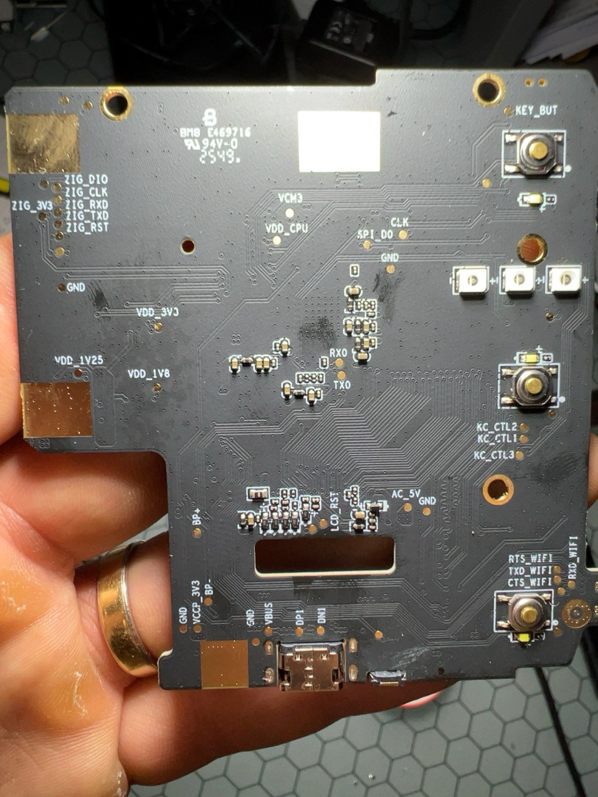

# Étape 2 — UART et accès au système

## But

Ouvrir une console UART pour documenter le démarrage et accéder au système avec les identifiants récupérés de façon autorisée.

## Matériel

Le T48 ne sert pas de terminal série. Il faut un adaptateur USB–UART TTL dont le niveau logique correspond à la carte.

| Adaptateur USB–UART | Carte TPP06 |
| --- | --- |
| GND | GND |
| RX | TX0 |
| TX | RX0, uniquement après validation du niveau logique |
| VCC | Non connecté |

Mesurer d’abord TX0 au repos par rapport à GND : utiliser une interface 1,8 V si la ligne est proche de 1,8 V, ou 3,3 V si elle est proche de 3,3 V. Ne jamais connecter le 5 V.



## Terminal

Ouvrir le terminal avant d’alimenter le panneau :

```text
115200 bauds, 8 bits, aucune parité, 1 bit d’arrêt, sans contrôle de flux
```

Commencer par GND et RX/TX0 pour lire les messages de démarrage. Une fois la tension logique confirmée, relier TX/RX0 pour envoyer des commandes.

## Accès système

- Utiliser uniquement le compte et le mot de passe récupérés pour cet appareil autorisé.
- Sauvegarder les journaux sans mots de passe, clés, jetons ni identifiants.
- Relever la version du système, les services de démarrage, les interfaces réseau et les périphériques reliés au processeur.

## Sortie de l’étape

Un journal de démarrage non sensible et une cartographie des interfaces nécessaires à la solution locale.
