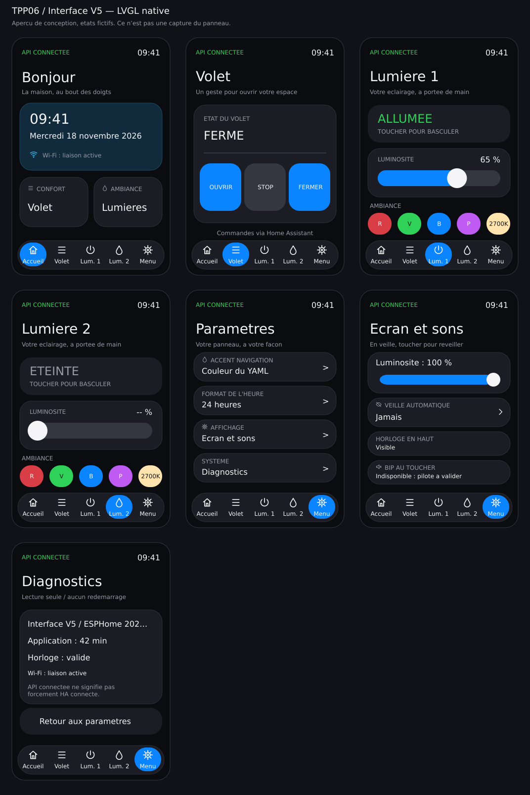

# Étape 6 — ESPHome + LVGL natif sur le TPP06

> [!CAUTION]
> **Le démarrage ESPHome reste expérimental.** L'essai temporaire depuis `/tmp`
> est validé. Le superviseur multiboot V1 de l'étape 7 conserve désormais Tuya,
> le Wi-Fi et le port 8090 comme secours, mais il doit encore être validé par un
> cycle électrique réel. Garder l'UART disponible pour ce premier essai.

Cette voie exécute **ESPHome lui-même** sur le Linux Anyka du TPP06. Elle ne
remplace pas le processeur par un ESP32 et n'utilise pas ESPHome comme simple
passerelle : le moteur LVGL d'ESPHome dessine directement dans le framebuffer
et reçoit le tactile Goodix par `evdev`.

> **Validé sur matériel le 17 novembre 2026.** Le binaire ARMv5 statique démarre
> sur le TPP06, détecte le framebuffer 320×480 BGR565 et le tactile Goodix, puis
> termine correctement l'initialisation ESPHome. Le bouton LVGL répond au toucher
> et affiche bien `TACTILE OK`. Le démarrage persistant est maintenant protégé
> par un repli automatique et une option explicite, mais reste non validé sur
> matériel.

## Ce qui a été adapté

Le correctif [esphome-tpp06-lvgl.patch](../../esphome-lvgl/esphome-tpp06-lvgl.patch)
ajoute à ESPHome :

- un afficheur `fbdev` pour `/dev/fb0`, 320×480, 16 bits ;
- la détection automatique RGB565/BGR565 du framebuffer Anyka ;
- un tactile `evdev` pour `/dev/input/event1` ;
- la lecture explicite des événements Linux 32 bits de 16 octets, nécessaire
  avec le noyau 4.4 du panneau ;
- la compatibilité avec les anciens appels système ARM 32 bits de Linux 4.4
  (`clock_gettime`, `nanosleep` et `_newselect`) malgré la toolchain time64 ;
- le chargement explicite des vraies fonctions `pthread` de la libc statique ;
- un stockage des préférences dans un répertoire inscriptible choisi par
  `ESPHOME_PREFDIR` ;
- un exemple LVGL avec mire RVB et bouton tactile ;
- un script reproductible de compilation croisée ARMv5/uClibc.

Le binaire obtenu lors de la première compilation mesure environ 2,8 Mio. Son
SHA-256 de référence est :

```text
9d2d42251db95ff8564c90cb2d978cf398a214fecc04ed302f6717d78e726802
```

## Configuration portable dans Device Builder

Le dépôt fournit maintenant une couche de compatibilité sous forme de
`external_components`. Il n'est plus nécessaire de modifier le code source
d'ESPHome. Dans le Device Builder officiel, importer uniquement
[`esphome/tpp06-device-builder.yaml`](../../esphome/tpp06-device-builder.yaml).

Les éléments propres à une maison sont regroupés dans `substitutions` en tête
du fichier : nom unique, adresse du panneau (`device_address`), référence de clé privée et identifiants des trois entités Home
Assistant. Le reste de la configuration, l'interface LVGL et les pilotes Linux
sont téléchargés depuis ce dépôt. Une nouvelle installation ne demande donc
que la modification de ces variables.

Deux modes sont proposés :

- `tpp06-device-builder.yaml` reste lié au modèle GitHub et reçoit ses mises à
  jour ; il est adapté quand seules les substitutions changent ;
- `tpp06-lvgl.yaml` est le modèle complet et librement modifiable. Le mécanisme
  **Prendre le contrôle** utilise `import_full_config: true` et copie
  automatiquement ce fichier complet dans Device Builder. Les pages, widgets,
  styles, positions et actions deviennent alors locaux et éditables. Seuls les
  pilotes matériels `external_components` continuent à venir de GitHub.

Le TPP06 nécessite toujours une compilation croisée ARMv5, mais aucun serveur
extérieur n'est requis. Le composant `host` détecte l'architecture de Home
Assistant : il utilise la toolchain Bootlin sur x86-64 et Zig natif sur un
Raspberry Pi/aarch64. L'archive choisie est téléchargée dans le cache de Device
Builder, vérifiée par son SHA-256 puis réutilisée. Toutes les compilations sont
effectuées localement par Device Builder. Le premier téléchargement est donc
plus long.

Si le journal contient un chemin `.remote_builds/...`, la compilation est
encore déportée. Ouvrir **Paramètres → Envoyer les compilations**, supprimer ou
désactiver le serveur associé, puis nettoyer les fichiers de compilation de
l'appareil. Un chemin local normal commence par `/config/.esphome/build/...`.

Le nouveau modèle attend `tpp06_api_encryption_key` dans `secrets.yaml` : une
clé aléatoire de 32 octets encodée en base64, privée et propre à l'installation.
Elle protège l'API et l'OTA. Ne jamais publier cette clé. Pour migrer un panneau
dont l'OTA est déjà chiffrée, conserver sa clé existante pour le premier transfert.

Pour une nouvelle installation uniquement, générer cette clé localement avec
`openssl rand -base64 32`, puis enregistrer le résultat sous
`tpp06_api_encryption_key` dans le `secrets.yaml` de Device Builder. Ne pas
utiliser la clé de test du dépôt. Aucun secret n'est fourni par GitHub.

### Heure sans le cloud Tuya

Le modèle utilise le composant ESPHome standard
[`time: platform: homeassistant`](https://esphome.io/components/time/homeassistant/).
L'heure arrive par l'API chiffrée existante ; aucun serveur NTP, accès cloud
Tuya ou identifiant supplémentaire n'est ajouté. Le fuseau n'est pas fixé dans
le YAML public : Home Assistant fournit celui de l'installation.

Après un démarrage à froid, l'horloge Linux peut rester en 1970 tant que Home
Assistant ne s'est pas connecté. Un client de journaux connecté ne prouve pas
que HA a fourni l'heure. Ne pas utiliser cette heure pour une action planifiée
sans vérifier `time.has_time`. `api.reboot_timeout: 0s` reste conservé :
l'absence de HA ne doit pas provoquer un redémarrage en boucle.

Le binaire v3 compilé dans Home Assistant a ensuite été testé pendant une
session autonome de 300 secondes : heure correcte avant la première connexion
API de diagnostic, neuf contrôles chiffrés réussis, mémoire résidente observée
constante à 4 932 Kio. La surveillance ADB du conteneur étant hors ligne, elle
a été reprise via Mint ; les premières minutes ne disposent donc pas de
relevés détaillés. Le retour automatique à Tuya, les sommes de contrôle des
fichiers d'origine et 90 secondes de stabilité après retour ont été vérifiés.
Ce test ne valide pas encore l'OTA autonome ou l'installation permanente.
Le binaire de l'essai précédent de 15 minutes ne contenait pas cet ajout.
Les délais du superviseur reposent sur des attentes relatives, et ceux du
HAL host sur `CLOCK_MONOTONIC`, pas sur l'heure civile à synchroniser.

### Variante mobile, inspirée d'iOS

Le fichier complet [tpp06-lvgl-mobile.yaml](../../esphome/tpp06-lvgl-mobile.yaml)
propose une interface alternative native 320 × 480 : cartes sombres arrondies,
navigation fixe, accueil avec date et salutation, volet, deux pages d'éclairage,
paramètres et diagnostics. Il conserve
les pilotes, le chiffrement API/OTA et les identifiants de commandes du modèle
classique. Les boutons font au minimum 44 × 44 pixels ; les valeurs de
luminosité sont lues depuis HA, sans envoyer de commande lors d'une mise à jour
d'état. Les commandes de couleur nécessitent une lampe qui les supporte.

L'onglet **Accueil** est la page de démarrage. La date française et l'heure
proviennent de l'horloge synchronisée avec HA ; avant synchronisation, elles
restent en attente. Les raccourcis ouvrent les pages, sans action immédiate sur
les équipements. L'état Wi-Fi lit uniquement le fichier Linux `carrier` de
`network_interface` (par défaut `wlan0`) : liaison active, sans liaison ou
inconnue. Ce n'est ni une mesure de puissance du signal, ni une vérification
d'Internet ou de la connexion HA ; aucun SSID, mot de passe ou IP n'est exposé.

L'onglet **Menu** permet de choisir le format 12/24 h, masquer l'horloge de
la barre supérieure (celle de l'accueil reste visible), et choisir l'accent
de navigation violet ou la couleur `ui_accent` du YAML. Ces trois préférences
utilisent le stockage ESPHome ; le lanceur doit conserver un
`ESPHOME_PREFDIR` accessible en écriture. Le superviseur du projet le fournit.
La page Diagnostics affiche la version, la durée de fonctionnement de
l'application (pas celle de Linux), la validité de l'horloge et la liaison
Wi-Fi. Le statut API global peut également refléter un client de journaux.
Aucun réglage réseau, redémarrage ou effacement n'est exécuté par ces pages.
La persistance des réglages et le rendu des pages autres que l'accueil restent
à confirmer lors d'un essai matériel.



**V4 compilée dans Home Assistant et testée temporairement, pas installée de
façon permanente.** Le 18 novembre 2026, une configuration personnelle dérivée
de ce modèle, avec les pilotes épinglés, a effectué une session autonome
limitée à 300 secondes, sans interface Tuya concurrente. Les 16 contrôles API
chiffrés ont réussi ; la mémoire résidente observée est restée à 5 352 Kio.
Les captures réelles de début et de fin montrent l'accueil, la date et la
liaison Wi-Fi, sans chevauchement visible. Aucun toucher, commande domotique
ou transfert OTA n'a été envoyé pendant cet essai.

Le journal confirme l'arrêt programmé à 300 secondes. Le retour à Tuya a été
vérifié après le redémarrage de secours, avec 90 secondes de stabilité,
Wi-Fi associé et les quatre fichiers d'origine suivis restaurés ou inchangés.
Un relevé ADB a échoué pendant la transition de retour ; il n'est pas compté
comme une sonde API réussie. Le programme principal installé n'a pas été
remplacé et les choix globaux restent `tuya` / `learning`.

**Anomalie connue :** l'heure affichée passe d'une heure locale à une valeur
décalée d'une heure dans la capture finale. La synchronisation initiale était
déjà présente avant la première sonde API de diagnostic ; cela ne valide pas
le maintien du fuseau pendant toute la session. L'interaction avec les clients
API de diagnostic reste à examiner : la version inspectée d'`aioesphomeapi`
répond automatiquement aux demandes d'heure avec son propre fuseau. Une
sonde sans commande domotique n'est donc pas un observateur passif de l'heure.
Ne pas considérer l'horloge comme validée
pour des commandes programmées. Les pages Menu/Paramètres, leur persistance,
l'OTA autonome et le démarrage permanent restent à valider.

Les quatre expressions de texte conditionnelles construisent explicitement
un `std::string` : sans cela, le C++ généré appelait `.c_str()` sur un
`const char*`. Un test de génération C++ couvre cette régression ; les
76 tests hors ligne passent. La compilation du binaire matériel a été faite
dans HA, pas sur Mint. Les captures et configurations personnelles restent
privées ; l'aperçu ci-dessus utilise des états fictifs et des polices de
navigateur, et ne constitue pas une capture du panneau.

Pour la préparer dans Builder, copier ce fichier sous un nouveau nom, choisir
un `device_name` unique et adapter les substitutions d'entités, titres et
couleurs `ui_*`. Réutiliser la clé privée existante uniquement pour une mise
à jour du même panneau. Pour une autre installation, fournir ses propres
secrets. Les coordonnées et les widgets restent intégralement éditables ;
aucune police cloud, image externe ou information personnelle n'est requise.
Compiler et télécharger dans HA, vérifier l'espace, puis effectuer un essai
limité avant de changer le démarrage. Ne pas lancer une OTA pendant un essai
automatisé. Le YAML personnel existant n'est pas remplacé automatiquement.

Ressources : [LVGL](https://lvgl.io/) et
[widgets LVGL d'ESPHome](https://esphome.io/components/lvgl/widgets/).

### Déplacer la configuration vers une autre installation

1. Importer le YAML public ; les composants viennent de GitHub, sans chemin
   vers un ordinateur Mint ni répertoire de composants local requis.
2. Choisir un nom unique par panneau, adapter les entités et les libellés.
   Conserver l'adresse IP connue lors d'une migration ; utiliser `.local`
   seulement après validation de la découverte depuis le nouveau serveur HA.
3. Pour le même panneau, transférer sa clé existante de manière privée ; pour
   un nouveau panneau, générer une nouvelle clé. Conserver aussi une sauvegarde
   privée du YAML personnalisé et de `secrets.yaml`.
4. Compiler dans Home Assistant avec la version ESPHome testée (2026.10.2).
   Internet est nécessaire au téléchargement initial des composants et de la
   chaîne de compilation. Aucun compte GitHub ni serveur Mint n'est requis.
5. Valider en essai limité avant tout changement de démarrage. La portabilité
   du modèle ne signifie pas que l'installation permanente est validée.

Pour figer une installation reproductible, utiliser le même commit testé dans
les références GitHub des `packages` et `external_components` au lieu de
suivre `main`. Ne jamais publier le binaire personnalisé : il peut contenir
la clé API/OTA et les entités de la maison, même si le code source est public.
Le mDNS exige que les annonces multicast atteignent HA ; entre VLAN, conserver
une adresse explicite tant que le relais mDNS n'est pas configuré et testé.

## Installation initiale et mises à jour OTA

### MAC réelle et découverte mDNS — premier essai matériel validé

Le nouveau modèle utilise `host.network_interface: wlan0` : la MAC est lue
sur le panneau par ioctl, jamais sur le serveur de compilation. Il refuse une
MAC vide/multicast et ne revient pas silencieusement à une identité fictive.
Supprimer l'ancien `host.mac_address`, incompatible avec cette option.

Le 18 novembre 2026, un essai de 150 secondes sur une copie réelle en RAM a
validé quatre connexions API chiffrées et le refus d'une connexion en clair.
La MAC de l'API correspond à `wlan0`. Depuis le système HA, les réponses A,
PTR, SRV et TXT ont confirmé le nom `.local`, le port API, la MAC et l'annonce
Noise. L'arrêt automatique a conservé Tuya, ADB et le programme en flash,
sans redémarrage Linux. Aucun équipement de la maison n'a été commandé.

Lors d'un nouvel essai limité en RAM, l'entrée HA a ensuite enregistré la
nouvelle identité et la clé correspondant au YAML privé. Une connexion TCP
depuis HA a été observée et l'entité de mise à jour est restée enregistrée.
Cela ne valide pas les commandes domotiques ni les automatisations existantes.
Le YAML peut désormais référencer les composants GitHub à un commit précis,
sans dossier de composants local. Conserver une sauvegarde privée avant migration.

Un essai OTA chiffré ultérieur du nouveau build a réussi son transfert, mais
deux mises à jour successives figurent dans le journal alors que le test n'en
demandait qu'une. Une vérification API a expiré pendant le second transfert ;
une vérification chiffrée ultérieure a réussi. Le programme flash est resté
inchangé et l'arrêt limité a préservé Tuya. L'origine du second transfert
reste à confirmer : ce test ne valide pas une séquence OTA complète isolée.
Ne pas lancer Installer dans Builder pendant un essai OTA automatisé.

Un nouvel essai limité à cinq minutes a ensuite validé un transfert OTA chiffré
unique du même build vers une vraie copie RAM. Les relances de l'émetteur
étaient désactivées : un appel d'envoi, une seule connexion entrante observée
par échantillonnage TCP (port source concordant) et une seule mise à jour
appliquée ont été relevés. Trois contrôles API chiffrés après transfert ont
réussi ; HA s'est reconnecté. L'empreinte du programme flash est restée inchangée,
Tuya est resté actif, Linux n'a pas redémarré et l'arrêt automatique a réussi.
La trace réseau complète a été récupérée après le premier rapport, qui l'avait
collectée trop tôt. Ce contrôle n'est pas une capture de tous les paquets et
n'explique pas rétrospectivement le double transfert précédent. Il ne valide
ni le bouton Installer de Builder, ni un changement de version, ni le démarrage
permanent. La copie RAM a été supprimée après vérification ; les preuves sont
conservées en privé.

Le parcours **Installer → Sans fil** du Builder a ensuite été testé pendant
une session RAM de 20 minutes. L'utilisateur a signalé « Installation réussie » ;
les contrôles côté panneau ont confirmé une mise à jour appliquée, un seul pair
TCP observé, 49 lectures API chiffrées réussies après transfert et l'arrêt
automatique prévu. Le processus Tuya est resté actif et le programme flash
inchangé. Le binaire reçu a été sauvegardé en privé avant suppression de la
copie temporaire. Cela ne valide ni l'installation persistante ni l'affichage.

### Affichage partagé : ne pas confondre OTA et interface LVGL

Pendant cet essai, les deux programmes ouvraient `/dev/fb0` et
`/dev/input/event1`. La capture réelle montrait l'horloge Tuya, pas une page
ESPHome. L'accès au même framebuffer rend possibles des écritures concurrentes ;
une API disponible ne prouve donc pas qu'ESPHome possède l'écran.

Le diagnostic en lecture seule [tpp06_display_check.sh](../../tools/tpp06_display_check.sh)
peut être exécuté avec `sh` sur le panneau via une console déjà authentifiée.
Il lit `/proc` et la géométrie sysfs, sans ouvrir les périphériques, envoyer de
signal, changer le réseau ni redémarrer. `CHECK_SHARED_FB0=yes` signale des
descripteurs ouverts par les deux programmes ; `not_observed` n'est **pas** une
preuve d'exclusivité. La sortie ne contient ni adresse réseau ni clé.

Le firmware actuellement installé a été récupéré en lecture seule et vérifié
par empreinte : il diffère de l'ancien dump. Dans ce firmware, `tal_disp_stop`
ne fait qu'une vérification d'argument et un affichage de diagnostic ;
`tuya_gui_hal_exit` appelle `ak_tde_exit`, sans constituer une pause graphique
réversible validée. Une tâche `gui_watchdog` est également présente.
Ne pas suspendre tout Tuya avec `SIGSTOP` pour contourner ce problème à distance.
La libération à chaud de l'affichage sans perdre réseau et secours reste à valider ;
aucune modification de l'application Tuya n'a été appliquée pour cet essai.

L'analyse suivante montre que le watchdog graphique est alimenté par un timer
LVGL de Tuya toutes les deux secondes. Il faut donc préserver sa boucle, pas
simplement arrêter la tâche graphique. La bibliothèque est également liée
avec `DT_SYMBOLIC` et utilise des appels locaux : remplacer une fonction
exportée par un simple préchargement n'est pas une interception validée.
Enfin, les deux programmes ouvrent le tactile ; masquer uniquement l'image
ne garantit pas que Tuya cesse de traiter les appuis.

La voie préparée reste donc le mode autonome : démarrer le réseau et le
secours indépendamment, puis laisser ESPHome seul gérer écran et tactile.
La sélection du profil actif et les refus d'un faux mode isolé sont corrigés
et testés hors ligne, voir [préparation réseau](07-tuya-cutter.md#apprentissage-puis-wi-fi-autonome).
Des essais séparés de démarrage à froid ont ensuite vérifié le réseau autonome,
l'affichage LVGL et le retour au système d'origine dans les limites décrites
dans le [bilan des essais](07-tuya-cutter.md#essai-autonome-prolongé-de-15-minutes).
Ils ne valident pas une bascule à chaud, une panne réseau réelle ou une coupure
électrique. Un accès de secours sur place reste nécessaire.

`tpp06_mdns` publie en IPv4 les enregistrements natifs ESPHome (MAC réelle,
version, service API et état de chiffrement) et le nom `device_name.local`.
Choisir un `device_name` unique par panneau. L'adaptateur surveille les changements
d'adresse et arrête ses annonces en cas de conflit de nom, sans couper l'accès IP.
La validation YAML, la génération de code, l'analyse syntaxique ARMv5 et l'essai
DNS-SD limité passent. L'enregistrement de l'appairage HA et l'OTA depuis Builder
en RAM ont été vérifiés ; l'adoption automatique,
les changements DHCP, les conflits de nom et la stabilité prolongée restent
à valider. Aucun démarrage permanent n'est validé par ces contrôles.

Lors de la migration, garder temporairement l'IP connue dans `device_address`.
Ne passer à `${device_name}.local` qu'après résolution et découverte réussies
depuis HA. Le changement de MAC peut créer une nouvelle identité dans HA :
ne supprimer l'ancienne entrée qu'après vérification des liens et automatisations.

### Migrer une ancienne MAC fictive dans Home Assistant

Une réauthentification peut être refusée avec « appareil différent » même si
la clé est correcte : l'ancienne entrée attend la MAC fictive, tandis que le
nouveau programme annonce celle de `wlan0`. Ne pas rétablir une MAC commune
pour contourner ce contrôle et ne pas supprimer l'ancienne entrée d'emblée.

1. Vérifier que l'essai ESPHome est encore actif et que l'API répond. Après
   l'arrêt automatique, le panneau peut rester joignable en ADB sans API ESPHome.
2. Fermer le message puis ouvrir **Paramètres → Appareils et services → Ajouter
   une intégration → ESPHome** (pas Device Builder).
3. Saisir l'adresse du panneau, le port API `6053` et la valeur privée référencée
   par `api.encryption.key`. Ne pas saisir le nom du secret ni générer une autre clé.
4. Si HA propose une résolution du conflit de nom, choisir **Migrer**, pas
   **Écraser**, pour conserver la configuration de l'entrée précédente.
5. Vérifier la nouvelle identité, la connexion chiffrée et les associations
   d'entités. La fermeture d'une fenêtre seule ne confirme pas l'appairage.

Voir la [procédure officielle de migration ESPHome dans HA](https://www.home-assistant.io/integrations/esphome/#name-conflict-resolution).
Cette procédure ne prolonge pas un essai temporaire et ne configure pas un
démarrage permanent. Ne publier ni clé, ni capture contenant des secrets.

### Accès IP de secours et anciennes versions

Dans la version ESPHome 2026.10.2 examinée, `mdns_host.cpp` ne publie pas
réellement les services mDNS. Le composant externe `host` ajoute donc
`use_address` : l'adresse explicite est transmise à `CORE.address`, aux
métadonnées de Builder et aux commandes de journaux/déploiement. Aucun fichier
d'ESPHome installé n'est modifié. Pour les anciennes versions sans adaptateur mDNS :

```yaml
substitutions:
  device_address: "192.0.2.1"  # Remplacer par l'adresse réelle du panneau.
host:
  use_address: "${device_address}"
mdns:
  disabled: true
```

Fusionner ces clés avec les sections existantes, sans supprimer les autres
options `host`. Cela ne change pas la configuration Wi-Fi du panneau et ne
crée pas de service mDNS. Une réservation DHCP évite que l'adresse change.
Le pont de compatibilité désactive le cache de configuration validée uniquement
pour les configurations `host.use_address`, afin que journaux et déploiement
rechargent bien le composant externe. Le cache de compilation est conservé.

Après modification, valider le YAML et actualiser Builder ; ne pas lancer une
installation pour simplement vérifier l'adresse. Les tests locaux couvrent
la validation, les métadonnées et le cache. Le 18 novembre 2026, Builder a
affiché le panneau en ligne et ses journaux ont confirmé la connexion API,
l'échange initial et la réception de messages ESPHome pendant un essai borné.
Un transfert OTA **chiffré** du binaire HA déjà validé a depuis réussi sur une
vraie copie en RAM : remplacement, réexécution, retour API et arrêt automatique
confirmés, sans modification du programme en flash ni reboot Linux. Le parcours
via le bouton Installer de Builder a également réussi en RAM, comme détaillé
plus haut. Si les
pilotes sont fournis par une source locale, conserver le dossier de composants
avec le YAML lors d'une migration vers une autre installation.

En dehors d'un essai, ESPHome est arrêté volontairement : l'indication hors
ligne est alors également attendue. « Non chiffré » concerne l'API sans clé
Noise configurée, indépendamment de la sécurité OTA. Le binaire testé exigeait
déjà une clé OTA alors que son API n'était pas chiffrée.

### Contrôle API sans action sur la maison

Depuis un environnement Python contenant `aioesphomeapi` (notamment celui
d'ESPHome), pendant un essai temporaire actif :

```bash
python tools/tpp06_api_check.py IP_DU_PANNEAU
```

Ce contrôle effectue la connexion au protocole ESPHome, lit les informations
du programme et liste les entités. Il ne commande aucun équipement, ne
téléverse rien et ne redémarre rien. Si nécessaire, fournir la clé via la
variable d'environnement `ESPHOME_API_KEY`, jamais dans le dépôt. Une API
accessible ne prouve pas que Home Assistant est connecté ou autorisé à agir.

Le modèle affiche désormais **API CONNECTEE**, plutôt que de confondre un
client de logs avec Home Assistant. Il expose la version ESPHome et la durée
de fonctionnement comme entités de diagnostic. Un état d'éclairage inconnu
ou indisponible n'est plus affiché comme « éteint ». Ces changements exigent
une nouvelle compilation puis un déploiement validé ; ils ne modifient pas le
binaire déjà installé.

Dans Home Assistant, vérifier séparément les options de l'intégration ESPHome
du panneau pour autoriser les actions Home Assistant, uniquement si souhaité.
Le diagnostic ne change pas cette permission et n'essaie pas les relais.

Essai matériel supplémentaire du 18 novembre 2026 : deux lectures complètes
du protocole API ont réussi pendant une session bornée à 120 secondes. Le
binaire existant a annoncé zéro entité et zéro service utilisateur. Une
connexion TCP établie depuis Home Assistant a été observée pendant l'essai ;
cela ne valide pas les actions, qui restent désactivées dans l'intégration.
Après l'arrêt programmé, le shell ADB a répondu, l'uptime a continué et le
processus Tuya est resté identique. Aucun reboot n'a été envoyé.

Un second essai borné à 180 secondes a ensuite confirmé la connexion et les
journaux depuis Device Builder, ainsi que plusieurs lectures API indépendantes.
À 65 et 125 secondes, le superviseur indiquait `esphome-healthy` et une
connexion TCP depuis Home Assistant était établie. L'arrêt à 180 secondes
s'est terminé par `session-complete`, sans échec comptabilisé ; le contrôle ADB
à 186 secondes a confirmé la continuité de l'uptime et le même processus Tuya.
Cela ne valide ni les commandes domotiques, ni l'OTA, ni un démarrage autonome.

Un nouveau binaire compilé dans Home Assistant le 18 novembre 2026 (7 640 472
octets, ARMv5TE EABI5 soft-float sans chargeur dynamique) a ensuite passé deux
essais de 120 secondes : copie réelle en RAM, puis exécution depuis la flash.
L'API a répondu aux contrôles à 5, 65 et 110 secondes dans chaque essai. Les
arrêts programmés ont conservé l'uptime, ADB et le processus Tuya ; le compteur
d'échecs est resté à zéro. Le binaire expose toujours zéro entité et zéro
service utilisateur : les diagnostics ajoutés au modèle ne sont pas encore
présents dans cette configuration personnelle.

Le remplacement a été effectué par copie dans un fichier de staging en flash,
vérification d'intégrité puis renommage, avec sauvegarde vérifiée de l'ancien
exécutable sur Mint. Dix anciennes archives de journaux ont été sauvegardées
et retirées du panneau pour garder la réserve de 2 Mio pendant le transfert.
Après remplacement, `/data` disposait d'environ 22,8 Mio libres. Aucun reboot
n'a été envoyé ; Tuya reste sélectionné pour le prochain démarrage. Ce
remplacement contrôlé n'est pas une validation du protocole OTA de Builder.

Le badge « en ligne » ne prouve pas à lui seul qu'ESPHome est actif : Builder
peut considérer le système Linux joignable alors que le port API est fermé.
L'erreur `Connection refused` sur le port 6053 après l'expiration d'un essai
est attendue ; elle ne signifie pas que le panneau a redémarré. Vérifier
séparément les journaux du superviseur et l'uptime avant de conclure à un crash.

### Limite d'espace pour l'OTA

Le backend OTA host écrit une copie `.ota.new` à côté de l'exécutable avant
remplacement. Il faut donc de la place pour **les deux versions simultanément**.
Le binaire de test examiné mesure environ 19,7 Mio, pour environ 8,6 Mio libres
sur `/data` : une nouvelle copie de même taille ne peut pas y tenir.
Le modèle ajoute `-Wl,--strip-all` afin d'exclure les tables de débogage/symboles
du prochain binaire. Vérifier sa taille finale et l'espace libre avant toute
OTA ; cette option ne garantit pas à elle seule que le fichier tiendra.
Ne pas remplacer directement le programme pendant un essai distant sans
sauvegarde et moyen de récupération.

Avant un transfert vers le programme installé en flash, vérifier l'espace :

```bash
python3 tools/tpp06_tuya_cutter.py IP_DU_PANNEAU ota-space-check --binary programme
```

Ce diagnostic ne transfère et ne supprime aucun fichier. Il réserve 2 Mio,
ne compte jamais l'ancien programme comme de l'espace libre, et refuse une
cible active différente du programme flash attendu. Il ne bloque pas le
bouton Installer de Builder : respecter son résultat avant toute OTA. Un
résultat positif ne valide ni l'architecture du binaire, ni le transfert.

Mesure du 18 novembre 2026 : une copie du programme existant, dépouillée des
symboles de débogage, passe de 20 679 080 à 7 990 192 octets. Les segments
chargeables restent identiques, hormis les références à la table des sections
dans l'en-tête ELF. Avec 8 990 720 octets libres sur `/data`, il manque encore
1 096 624 octets pour conserver la réserve de 2 Mio pendant le staging. Cette
copie n'a pas été déployée ; la taille du prochain programme doit être mesurée
après sa compilation dans Home Assistant.

**Un essai temporaire par lien symbolique n'isole pas l'OTA.** Le backend host
résout `/proc/self/exe` : une mise à jour peut donc remplacer le fichier flash
visé par le lien. Ne pas utiliser OTA pour tester une nouvelle version dans
ce type d'essai. Un futur essai OTA isolé nécessitera une vraie copie distincte
et des contrôles de RAM/espace. Dans le code host examiné, le redémarrage OTA
réexécute le programme via `execv`, pas le système Linux ; cela ne garantit
pas le bon fonctionnement de la nouvelle version.

Le bouton **Installer** de Device Builder ne peut pas installer directement le
premier binaire dans un système Tuya intact. La compilation est néanmoins
réussie lorsque le journal affiche `Successfully compiled program`. Télécharger
alors l'exécutable et effectuer le premier déploiement réversible avec Tuya
Cutter, comme décrit ci-dessous.

À partir de la version `0.1.3`, le binaire expose ensuite l'OTA ESPHome sur le
port `8082`. Les versions suivantes peuvent donc être installées directement
depuis Device Builder sur l'adresse du panneau. Les anciennes configurations
utilisent `ota_password` ; le nouveau modèle exige le chiffrement OTA. Les
implémentations MD5 et SHA-256 portables incluses dans ce dépôt évitent la
dépendance OpenSSL absente du Linux Tuya.

À partir de la version `0.1.4`, cette compilation locale fonctionne également
quand Device Builder tourne sur un Raspberry Pi ARM64. Après une mise à niveau
depuis `0.1.3`, nettoyer une fois les fichiers de compilation de l'appareil.

## Compiler

Le correctif a été construit sur la révision ESPHome `9bf2bbc` (branche
`dev`, version `2026.12.0-dev`). ESPHome utilise C++20 ; l'ancien compilateur
GCC 6 du SDK Anyka ne suffit donc pas. Utiliser la toolchain officielle Bootlin
ARMv5 EABI/uClibc stable 2026.08-1, GCC 15.3.

```bash
git clone https://github.com/esphome/esphome.git
cd esphome
git checkout 9bf2bbc
git am /chemin/esphome-tpp06-lvgl.patch

export TPP06_TOOLCHAIN_PREFIX=/opt/armv5-eabi--uclibc--stable-2026.08-1/bin/arm-linux
export ESPHOME_PYTHON=/chemin/venv-esphome/bin/python
./tpp06/build.sh
```

Résultat :

```text
tpp06/.esphome/build/tpp06-lvgl/.pioenvs/tpp06-lvgl/program
```

Vérifier qu'il est statique et ARM EABI5 :

```bash
${TPP06_TOOLCHAIN_PREFIX}-readelf -h -l \
  tpp06/.esphome/build/tpp06-lvgl/.pioenvs/tpp06-lvgl/program
```

## Premier essai temporaire

La méthode recommandée utilise Tuya Cutter : l'essai ESPHome garde Tuya actif,
réutilise le binaire flash si sa somme correspond et dispose d'un arrêt
automatique à 60 secondes. Ce mécanisme n'est pas une garantie de récupération
en cas de panne du noyau ou du matériel. Les préférences de l'essai sont
séparées sous `/data/tpp06-cutter/esphome-test-prefs` :

```bash
python3 tools/tpp06_tuya_cutter.py --yes ADRESSE_IP_DU_PANNEAU \
  test esphome --binary \
  tpp06/.esphome/build/tpp06-lvgl/.pioenvs/tpp06-lvgl/program
```

Arrêt sûr et reprise immédiate de Tuya :

```bash
python3 tools/tpp06_tuya_cutter.py ADRESSE_IP_DU_PANNEAU stop-test
```

La procédure manuelle historique ci-dessous n'est **pas équivalente** à l'essai
borné : elle suspend Tuya et n'a pas d'arrêt automatique. Ne pas l'utiliser à
distance sans accès physique de secours ; préférer la commande Cutter.

1. Redémarrer le panneau pour retrouver ADB sur `5555`, puis se connecter selon
   l'[étape 4](04-adb-wifi-sans-uart.md).
2. Copier le programme uniquement dans `/tmp`. Si `adb push` ne fonctionne pas
   avec cet ancien démon, ouvrir un shell root sur le panneau et lancer :

   ```sh
   nc -l -p 9001 > /tmp/esphome-tpp06-lvgl
   ```

   Depuis le PC, dans un second terminal :

   ```bash
   nc ADRESSE_IP_DU_PANNEAU 9001 < \
     tpp06/.esphome/build/tpp06-lvgl/.pioenvs/tpp06-lvgl/program
   ```

3. Sur le panneau, rendre le fichier exécutable, vérifier sa somme, puis mettre
   temporairement l'interface Tuya en pause :

   ```sh
   chmod 755 /tmp/esphome-tpp06-lvgl
   sha256sum /tmp/esphome-tpp06-lvgl
   ui_pid=$(pidof voice_control_ak3760e)
   kill -STOP "$ui_pid"
   /tmp/esphome-tpp06-lvgl
   ```

4. Vérifier les trois bandes rouge, verte et bleue, puis le bouton `TOUCHER`.
   Après `Ctrl+C`, restaurer immédiatement Tuya :

   ```sh
   kill -CONT "$ui_pid"
   rm /tmp/esphome-tpp06-lvgl
   ```

Ne jamais créer de service permanent tant que l'orientation, les couleurs, le
tactile, la sortie du programme et le retour de l'interface Tuya n'ont pas été
validés plusieurs fois.

## Suite

La configuration portable contient déjà les pages Home Assistant pour le volet
et les deux éclairages. La suppression du cloud Tuya reste une opération
séparée et réversible.
