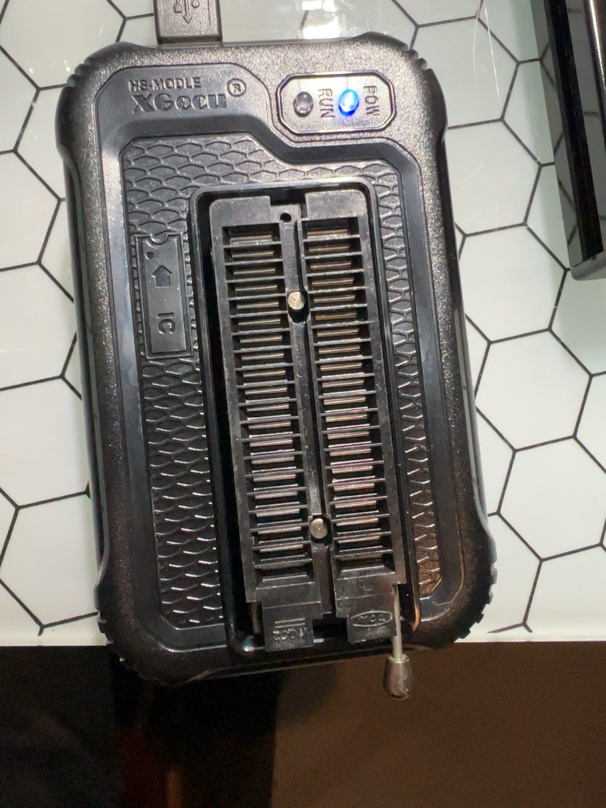
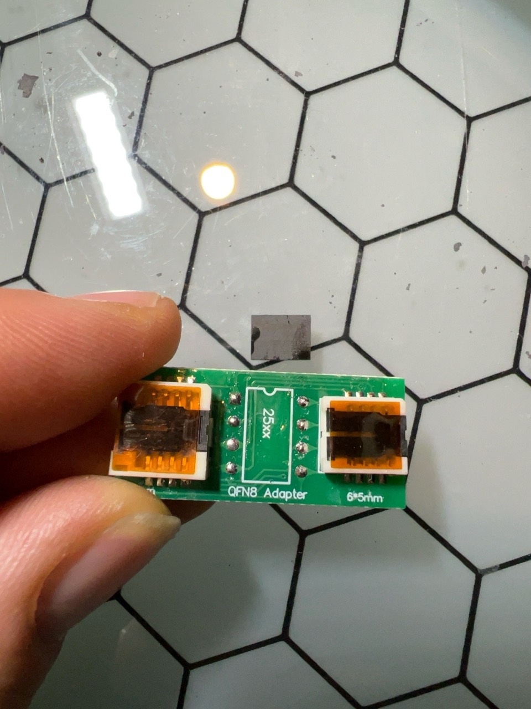
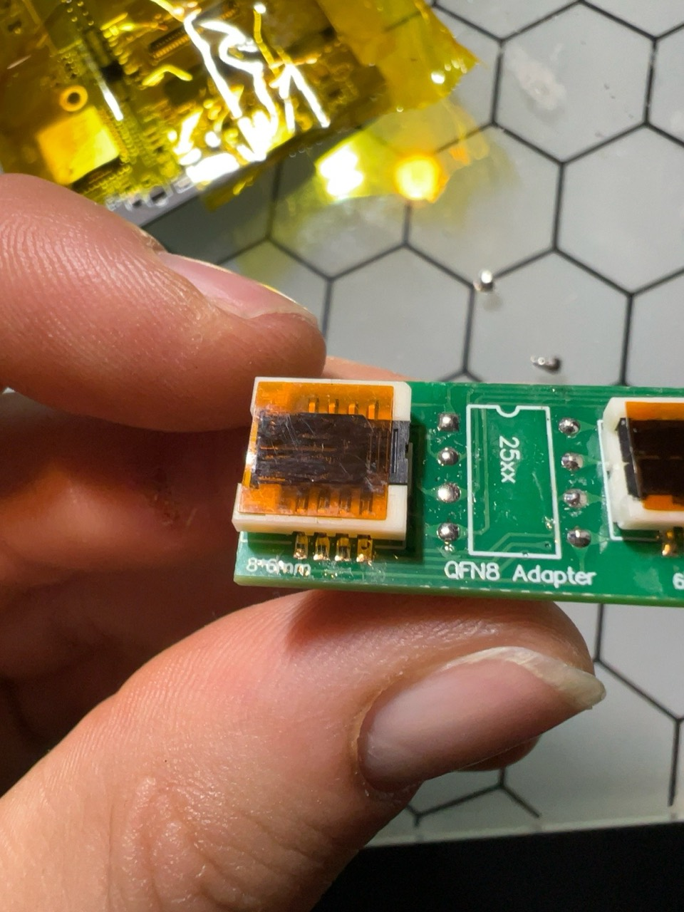
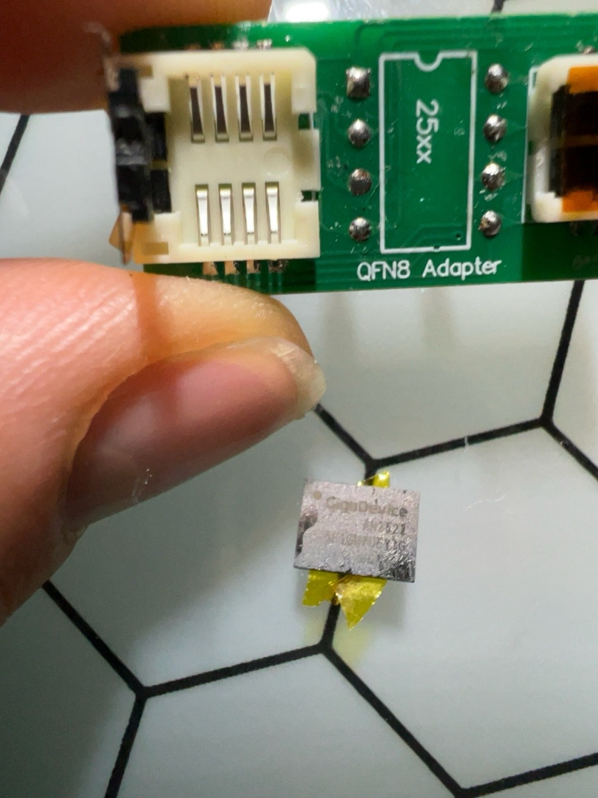
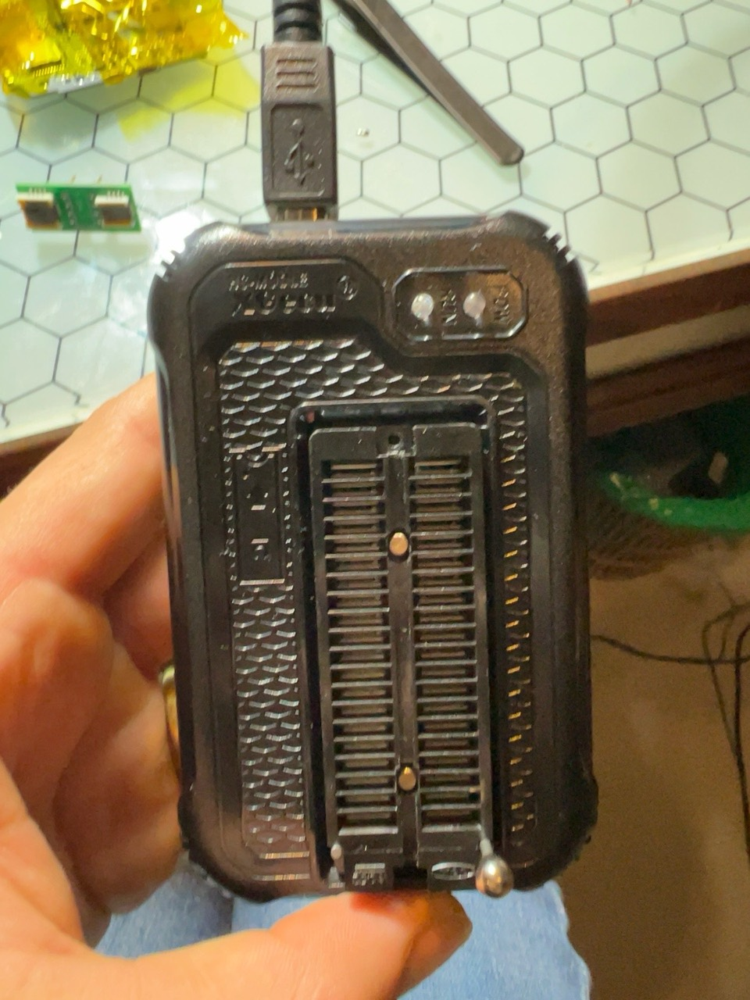
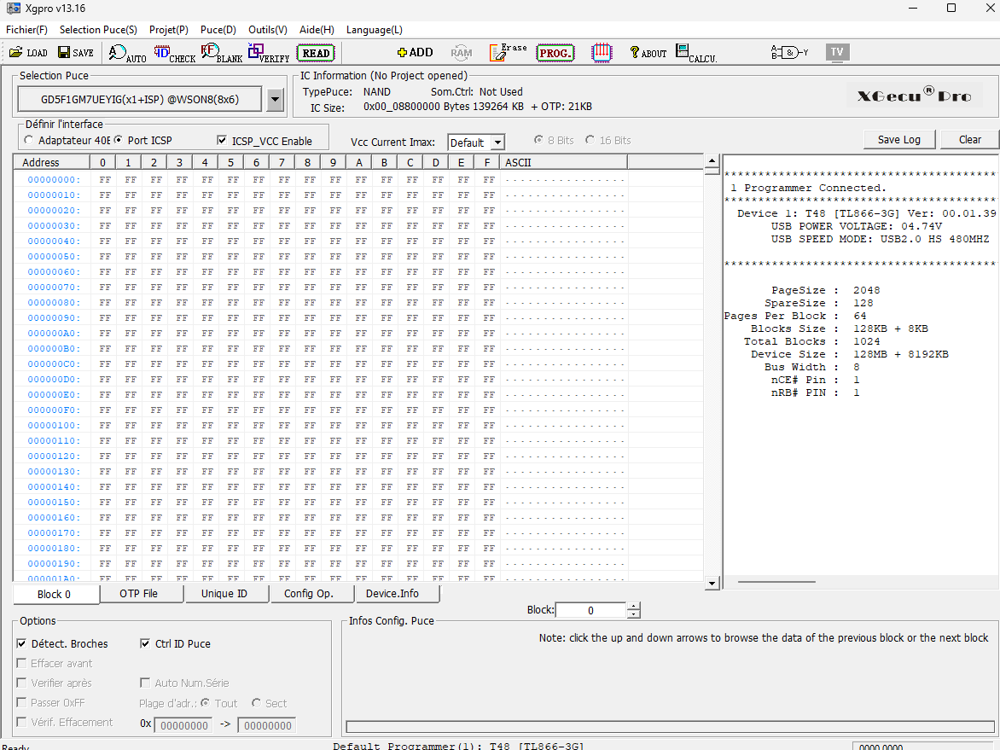
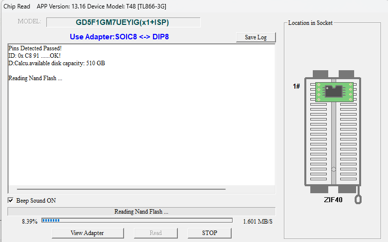
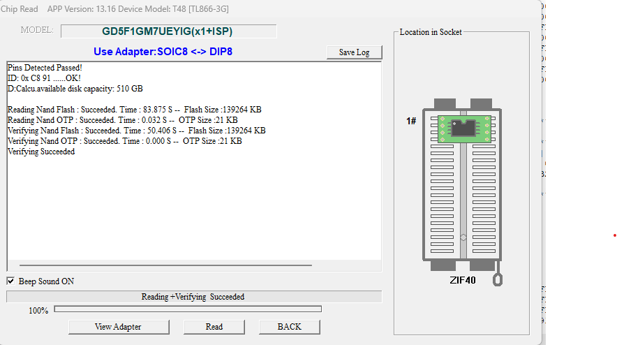
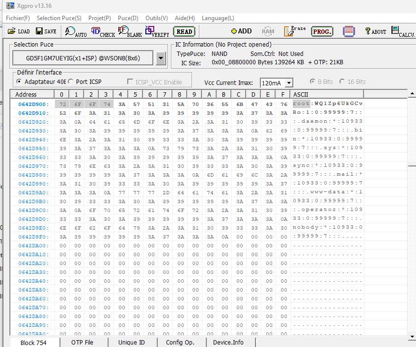

# Lecture de la NAND

Cette procédure concerne la NAND GigaDevice `GD5F1GM7UEYIG` de la carte `TPP06-Z-AK V1.0.2`.

## Résultat obtenu

La puce a été lue hors carte avec un XGecu T48 et un adaptateur QFN/WSON-8 **8 × 6 mm**. La lecture et la vérification par XGPro ont réussi. Le panneau a ensuite redémarré après remontage de la NAND.

Les images suivantes documentent les étapes. Les fichiers binaires de sauvegarde ne sont pas inclus dans ce dépôt.

## Matériel et orientation

- 
- 
- 
- 
- 

Aligner le repère de broche 1 de la NAND avec le repère du socket. Débrancher l’USB du T48 avant chaque manipulation mécanique.

## XGPro

Sélectionner le modèle exact et utiliser l’adaptateur approprié. Vérifier l’identifiant avant de lancer une lecture.

- 
- 
- 
- 

Ne jamais cliquer sur **Erase** ou **Program** pour effectuer une sauvegarde.

## Remontage et test

La NAND a été ressoudée avec son repère 1 dans le même coin que le repère de la carte. Le démarrage confirmé est documenté dans [Carte et remontage](remontage.md).
