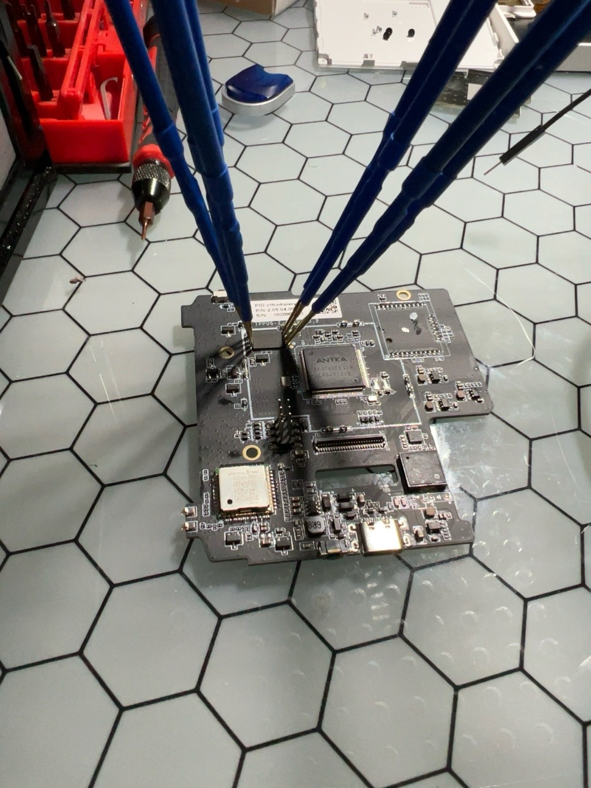
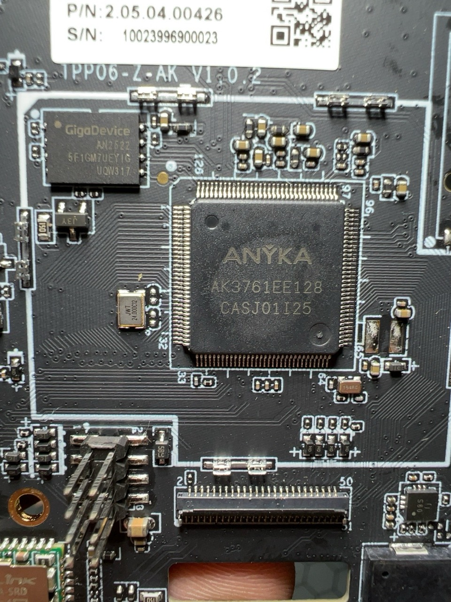
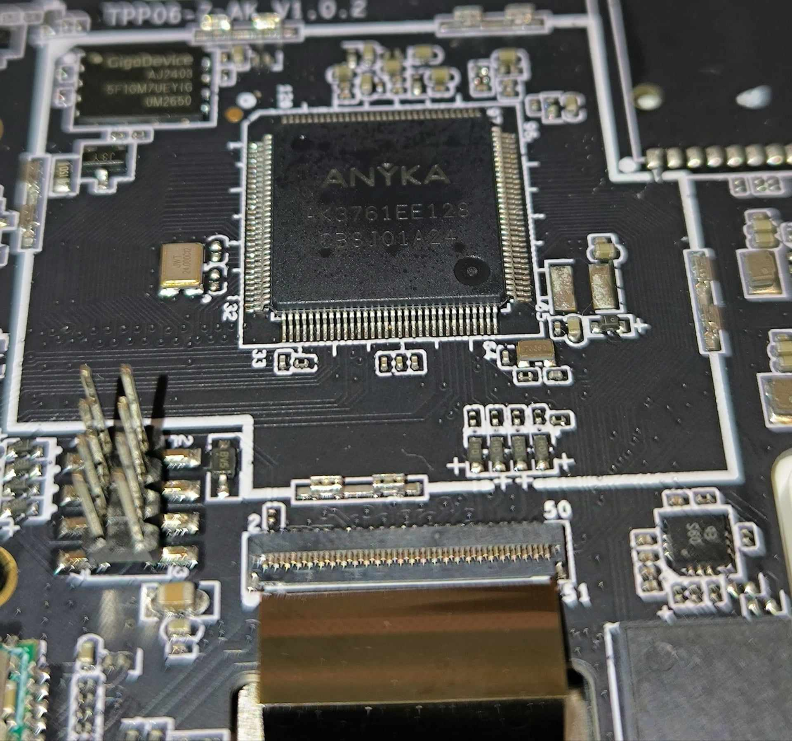
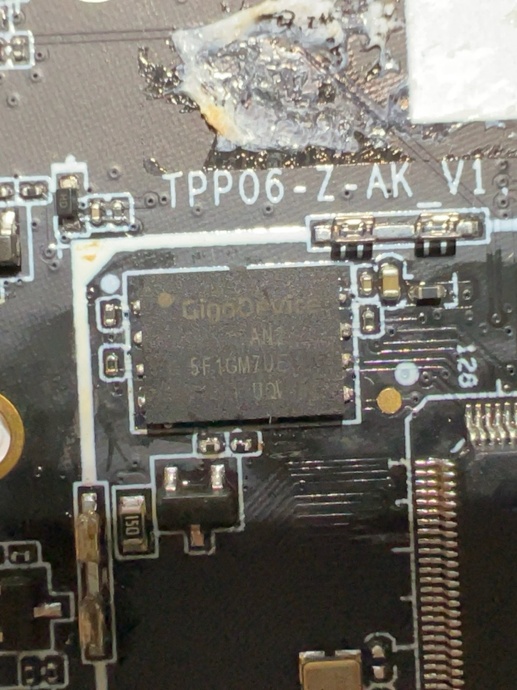
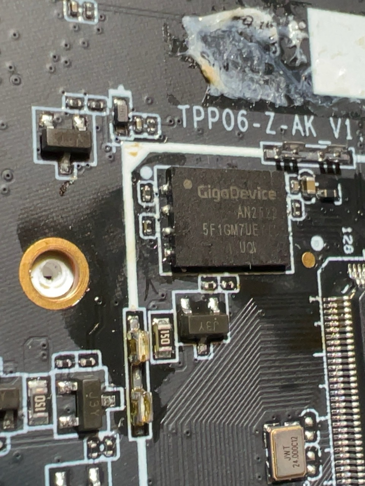
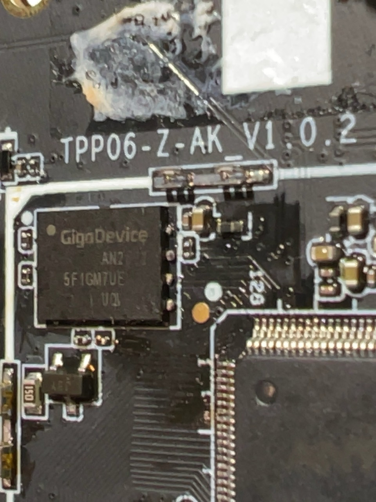
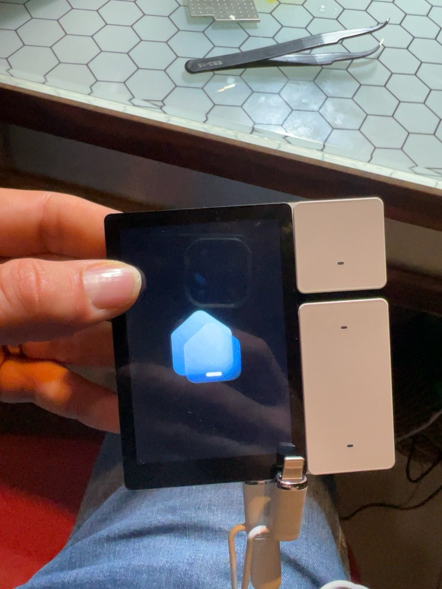

# Carte et remontage

## Références

- 
- 
- 

## Ressoudage

Le point doré de la NAND est le repère de broche 1. Il doit être face au repère de broche 1 sur le circuit imprimé.

- 
- 
- 

Après nettoyage du flux, vérifier visuellement l’absence de pont de soudure avant remise sous tension.

## Validation

Le logo de démarrage du panneau est apparu après le remontage :

